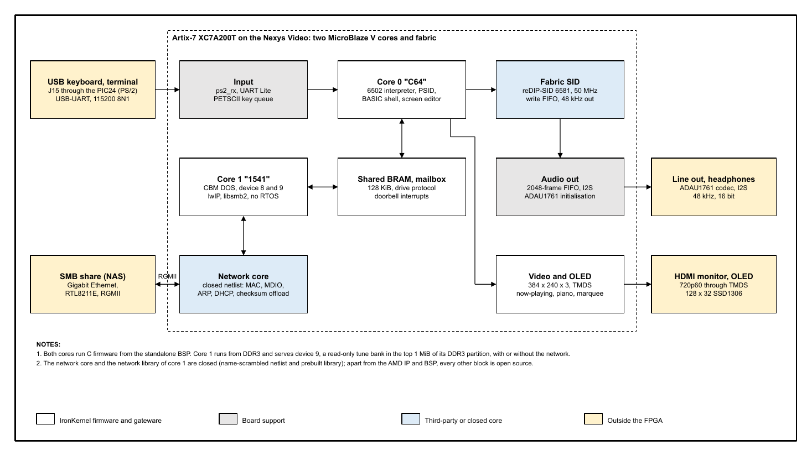

<table style="width:100%; border:none; margin:0; padding:0;">
<tr>
<td style="text-align:left; border:none; padding:0; width:50%;"></td>
<td style="text-align:right; border:none; padding:0; width:50%; vertical-align:bottom;"><strong>Product Brief</strong> Revision 11-10-2026</td>
</tr>
</table>

<h1 style="font-size:30px; margin-top:18px;">IronKernel 64</h1>

A SID music machine on a Digilent Nexys Video: two MicroBlaze V cores, an open-source SID chip in the FPGA, a C64-style shell on HDMI and UART, and a drive that serves tunes from a network share or from the image.

IronKernel 64 plays SID music the way a C64 does, on an Artix-7 FPGA board. Type `LOAD"$",9`, `LIST`, `LOAD"CANON*",9` and `RUN` on a USB keyboard or a UART terminal. Core 0 runs the screen editor and command shell, a 6502 interpreter and a PSID player, and sends every SID register write with its clock cycle to the reDIP-SID core in the fabric. Core 1 emulates a 1541-style disk drive: device 8 reads an SMB network share, device 9 is a read-only tune bank held in DDR3. The picture is 720p60 HDMI with a now-playing screen, and the sound leaves through the board's ADAU1761 codec. The firmware is C, and the gateware and firmware are open source apart from the network core.

### Highlights

- SID in gateware: reDIP-SID, one 6581, fed at its own 985,248 Hz clock with cycle-exact register writes
- Two MicroBlaze V cores: a "C64" core with the shell and the 6502, a "1541" core with CBM DOS and the network
- C64-style commands: LOAD, LIST, RUN, NEW, the @ wedge, wildcards, cursor-edit of directory lines
- Two drives: device 8 is an SMB share over Gigabit Ethernet, device 9 is a built-in bank that works without a network
- Now-playing screen with song select, voice level bars and two piano keyboards; 128 x 32 OLED marquee
- PSID v1 to v4, vertical-blank and CIA-timer tunes, PAL and NTSC
- UART mirrors the screen; Ctrl-B opens an engineering command line
- Public tune bank of 9 arrangements of public-domain pieces
- Stand-alone boot from one QSPI flash image: bitstream, both firmware images and the tune bank, `READY.` about 4 s after power-up

### At a glance

| Item | Value |
|---|---|
| Board | Digilent Nexys Video, XC7A200T, 512 MiB DDR3 |
| Processors | 2 x MicroBlaze V RV32IMC, 100 MHz |
| SID | reDIP-SID 6581 at 50 MHz, 48 kHz out |
| Video | 720p60 HDMI, 384 x 240 drawn 3x |
| Audio | ADAU1761, 16 bit, 48 kHz |
| Input | USB keyboard (J15), USB-UART 115200 |
| FPGA use | LUT 29.3 %, BRAM 78.5 %, DSP 1.6 % |
| Core 0 image | 89,686 B text, 96.0 % of 256 KiB LMB |

## How it works

**Figure 1.** IronKernel 64 and what it connects to (product-brief, sheet 1)

A key typed on the keyboard or the UART reaches core 0. `LOAD` becomes a request in a shared 128 KiB BRAM, and a mailbox doorbell wakes core 1, which reads the file from the share or from the bank and answers. `RUN` parses the PSID header and runs the tune's init and play routines on the 6502 interpreter; each SID write is queued with its cycle and replayed by the fabric SID, whose 48 kHz output reaches the codec without CPU time. Video, the OLED and the keyboard are fabric blocks on core 0's register window.

| Area | Features |
|---|---|
| Shell | 40 x 25 screen editor, RETURN reads the logical line, C64 error messages, boot banner with the probed RAM size |
| Commands | `LOAD"name",8` or `,9`, `LOAD"$"`, `LIST`, `RUN`, `NEW`, `@`, `@$pattern`, CBM wildcards |
| Keys | cursor, Home, Insert, Delete, function keys, colours, Caps Lock as SHIFT LOCK; X or RUN/STOP breaks a tune; `+`, `-`, `1` to `9` pick songs |
| Player | PSID v1 to v4, VBI and CIA speed, PAL and NTSC, 6502 with documented and stable illegal opcodes |
| SID | reDIP-SID 6581 in fabric, 512-entry timestamped write FIFO, OSC3 and ENV3 read-back |
| Video | 720p60 CEA-861, 3x pixel scaling, Colodore palette, MEGA65 Open ROMs font |
| Drive | CBM DOS channels, byte-exact directory program, status codes, device 8 SMB 2/3 client, device 9 bank |
| Network | Gigabit RGMII, DHCP in the closed network core, lwIP and libsmb2 without an RTOS |
| Tools | host tests, RTL regression with negative controls, bank packer, siddump-style SID dump over the UART |

## Verification

<!-- Numbers re-read 11-10-2026 from the release build: build/release_hw/build_info.txt (f0314eb3), build/regression_release.log, host tests rebuilt and run, public_bank_test.py. -->

| Evidence | Result |
|---|---|
| RTL regression (reset-policy scan, 16 benches each with a forced-failure control) | 33 passed, 0 failed |
| Timing of the release build, 0 failing endpoints | WNS 0.083 ns, WHS 0.012 ns |
| Host tests: drive bank, CBM DOS, CLI, piano, OLED, PSID, SID, screen (`ik64_host_tests.sh`) | 12 of 12 PASS |
| Public bank: 9 tunes through the real PSID loader, 6502 and memory map | all PASS; worst play call 3,266 of 20,000 cycles |
| Board: boot, DDR3, codec, Gigabit link, SMB 3.1.1, `LOAD` and `RUN` from the share | demonstrated 11-09-2026 over the UART |
| Board: boot from QSPI flash, owner and public release images, device 9 bank, share, `VERSION` | demonstrated 11-10-2026 |
| Board: listening check against sidplayfp, 30-minute soak | to verify |

## Offerings

| Offering | Content |
|---|---|
| Source | firmware, tools and scripts under GPL-3.0-or-later; gateware under GPL-3.0-or-later or CERN-OHL-S-2.0 |
| Network core | closed netlist and library, with an interface document; licence exception for use with IronKernel 64 (README) |
| Images | flash image `ik64_qspi.mcs` and bitstream `c64_qspi.bit` with SHA-256 sums; no share configured |
| Services | by agreement with the owner |

### Hardware needed

A Digilent Nexys Video, a USB keyboard on J15, an HDMI monitor, a line input or headphones on the audio jacks, a USB cable for the UART, and for device 8 an SMB share on the Ethernet LAN. Device 9 needs no network. Not included: any C64 ROM image, HVSC tunes, microSD support.

## Open-source components

The full list with commits, licences and file locations is in chapter 14 of the specification and in `docs/THIRD_PARTY_NOTICES.md`.

| Component | Licence | Used for |
|---|---|---|
| reDIP-SID (Dag Lem) | CERN-OHL-S-2.0 | SID chip in fabric |
| reSID tables (Dag Lem) | GPL-2.0-or-later | waveform and filter tables |
| libsmb2 (Ronnie Sahlberg) | LGPL-2.1-or-later | SMB client of device 8 |
| lwIP 2.2.0 | BSD-3-Clause | TCP/IP |
| MEGA65 Open ROMs font | LGPL-3.0-or-later | character set |
| Dormann 6502 tests | GPL-3.0 | CPU self test |
| Digilent board files, master XDC | MIT | pins and DDR3 settings |
| AMD IP and BSP | AMD licence | MicroBlaze V, DDR3, AXI blocks |
| IronKernel network core | closed | Ethernet MAC and protocols |

Commodore 64 is a trademark of its owner. IronKernel 64 is an unaffiliated hobby project and contains no Commodore ROMs.
