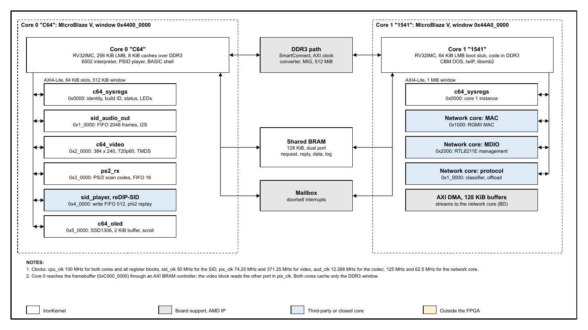
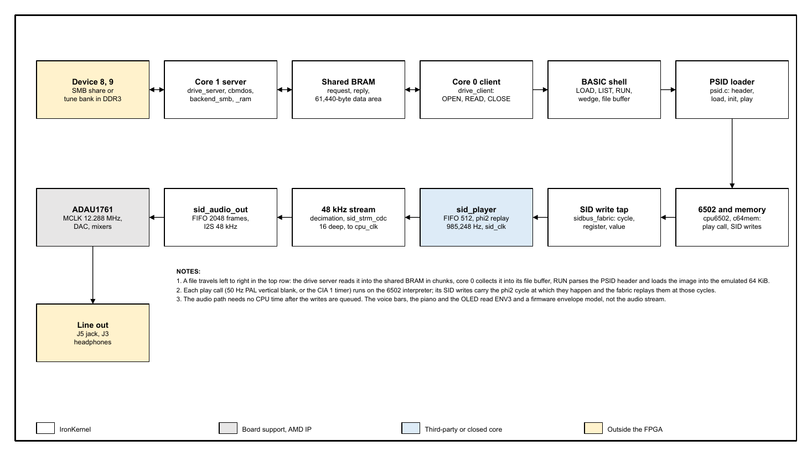

<style>
  .markdown-body h1, .markdown-body h2 { color: #1381ee; border-bottom: 2px solid #1381ee; }
  .markdown-body h3 { color: #242424; }
  .markdown-body table th { background: #e8f2fd; }
  .markdown-body table { font-size: 11px; }
  .markdown-body table td, .markdown-body table th { padding: 3px 6px; }
  .markdown-body table.credits { font-size: 9.5px; }
  .markdown-body table.credits td, .markdown-body table.credits th { padding: 2px 4px; word-break: break-word; }
</style>

<table style="width:100%; border:none; margin:0; padding:0;">
<tr>
<td style="text-align:left; border:none; padding:0; width:50%;"></td>
<td style="text-align:right; border:none; padding:0; width:50%;"><strong>Revision 11-10-2026</strong></td>
</tr>
</table>
<hr style="border:none; border-top:2px solid #000; margin:4px 0 12px 0;">

<div style="height:230px;"></div>

<h1 style="font-size:36px; text-align:center; border:none;">IronKernel 64 Specification</h1>

<p style="text-align:center; font-size:16px;">A SID music machine with a C64-style shell on two MicroBlaze V cores, for the Digilent Nexys Video</p>

<p style="text-align:center; font-size:14px;">Revision 11-10-2026</p>

<div style="page-break-after: always;"></div>

## Quick Start

1. Install the third-party trees at their fixed commits and build the bitstream and both firmware images (Vivado and Vitis 2026.1):
   `python -I tools/setup_third_party.py`, then `fpga/build_bitstream.tcl` through `scripts/ik64_vivado.ps1`, then `fw_c64/build.ps1` and `fw_1541/build.ps1`.
2. Run the host tests and the simulation regression: `scripts/ik64_regression.ps1`, `python -I tools/public_bank_test.py`, and the `tools/*_host_test.c` programs.
3. Make the flash image (`scripts/make_qspi.ps1`), write it (`scripts/program_qspi.ps1 -Program build/qspi/ik64_qspi.mcs`), set JP4 to "SPI Flash" and press PROG. Open the UART at 115200 8N1 and type `LOAD"$",9`, `LIST`, `LOAD"CANON*",9`, `RUN`.

Without a build, the release image `ik64_qspi.mcs` goes straight to step 3. Section 10 gives the details; section 10.6 covers the flash image and the JTAG development flow.

<div style="page-break-after: always;"></div>

## Table of Contents

1. Overview
2. System Context
3. Requirements
4. Architecture
5. Interfaces
6. Clocking and Reset
7. Memory Map and Registers
8. Data Flow and Protocol
9. User Interface and Software API
10. Build, Integration, and Configuration
11. Verification
12. Example Sequences
13. Constraints and Limitations
14. Sources, Credits and Licences
15. Appendix A: Public tune bank
16. Appendix B: HVSC test tunes (not redistributed)
17. Appendix C: Board and tool sharing (owner only)

<div style="page-break-after: always;"></div>

## 1. Overview

IronKernel 64 is a SID music machine with a C64-style shell, built on a Digilent Nexys Video (AMD Artix-7 XC7A200T). Two MicroBlaze V (RISC-V) cores run C firmware. Core 0 ("C64") runs the screen editor and BASIC-style command shell, a 6502 interpreter and a PSID player. Core 1 ("1541") emulates a disk drive: it serves CBM DOS file requests from a network share (device 8) and from a built-in tune bank (device 9). The SID chip is an open-source gateware core (reDIP-SID) in the FPGA, and its output goes through the ADAU1761 codec. Video is 720p60 over HDMI with a 384 x 240 framebuffer drawn three times larger. A 128 x 32 OLED shows the now-playing text and level bars.

- **Primary function:** load a PSID tune from a drive with C64-style commands, run its 6502 code in an interpreter and play the SID register writes on a fabric SID.
- **Supported modes:** PSID v1 to v4, vertical-blank and CIA-timer play speed, PAL and NTSC tunes, one 6581 SID at $D400.
- **Non-goals:** RSID tunes, MUS data, a BASIC interpreter, writing to a drive, microSD storage, a second or third SID.

The product name is IronKernel 64. Commodore 64 is a trademark of its owner; this is an unaffiliated hobby project and it contains no Commodore ROMs (section 14.5).

<div style="page-break-after: always;"></div>

## 2. System Context

- **Target device:** Digilent Nexys Video, Artix-7 XC7A200T-1SBG484, 512 MiB DDR3 (MT41K256M16), RTL8211E Gigabit PHY, ADAU1761 codec, SSD1306 OLED, PIC24 USB host on J15.
- **Operating environment:** bare metal. Both cores run C firmware on the AMD standalone BSP (newlib), no RTOS and no Linux.
- **Dependencies:** the AMD IP and tools (Vivado and Vitis 2026.1), reDIP-SID gateware, the closed network core netlist `fpga/netlist/ik64_net_core.dcp` and its firmware library `fw_1541/lib/libik64_netcore.a`, lwIP 2.2.0 and libsmb2.
- **Host equipment:** a USB keyboard on J15, an HDMI monitor, a line-level audio input or headphones, a UART terminal on the USB-UART at 115200 8N1, and for device 8 an SMB share reachable on the Ethernet LAN.

<div style="page-break-after: always;"></div>

## 3. Requirements

### Functional requirements

- FR-001: the boot screen shows `**** IRONKERNEL 64 BASIC V2 ****`, the probed DDR3 size and `READY.` on the HDMI picture and, mirrored as ASCII, on the UART.
- FR-002: `LOAD"$",8`, `LOAD"$",9` and `LIST` show a byte-exact 1541-style directory program; RETURN on a cursor-edited directory line runs it as a `LOAD`.
- FR-003: `LOAD"NAME",8|9` loads a PSID file with CBM wildcards; `RUN` plays it on the fabric SID.
- FR-004: the player accepts PSID v1 to v4 with vertical-blank or CIA-timer speed, PAL or NTSC clock, and rejects RSID, MUS data and play address 0 with a C64-style error.
- FR-005: device 9 answers with or without a network.
- FR-006: a UART terminal and a USB keyboard give the same key queue; Ctrl-B on the UART toggles an engineering command line.

### Performance requirements

| Item | Target | Notes |
|---|---:|---|
| Audio sample rate | 48 kHz, 16 bit | mono SID output to left and right |
| SID clock | 985,248 Hz (PAL phi2) | exact rational generator on the 50 MHz `sid_clk` |
| Video | 1280 x 720 at 60 Hz | CEA-861, pixel clock 74.25 MHz, picture 1152 x 720 with a 64-pixel pillarbox |
| Play call budget | 20,000 cycles | cap per play call in `c64mem.c`; worst measured in the public bank 3,266 cycles |
| Timing | WNS and WHS at or above 0 | enforced by `fpga/build_bitstream.tcl` |
| Utilization gate | at most 80 % | enforced by the build script |

### Compliance requirements

- PSID file format as documented in the HVSC `SID_file_format` text.
- CEA-861 720p60 timing for the HDMI output (DVI signalling, no audio, no InfoFrames).
- CERN-OHL-S-2.0 for the bitstream as a whole (section 14).

<div style="page-break-after: always;"></div>

## 4. Architecture

### Block diagram

**Figure 4-1.** Architecture: two cores, register windows, shared BRAM and DDR3 (spec, sheet 1)



<!-- Figure source: diagrams/src/spec.js. Reference copy in Google Drive: none yet (to be added by the owner). -->

### Major modules

- `c64_top` (`fpga/hdl/c64_top.sv`): board top. Owns the pins, the MMCMs, the global buffers, the reset tree and every I/O primitive (OSERDESE2, OBUFDS, ODDR, IOBUF), and instantiates the block design `c64_cpu`, the register windows and the blocks below.
- `c64_cpu` (`fpga/bd/c64_bd.tcl`): the block design with two MicroBlaze V cores, the shared BRAM, the mailbox and the DDR3 SmartConnect.
- `c64_sysregs`: per-core identity, build ID, status and LED registers.
- `sid_player`: SID write replay and 48 kHz stream.
- `sid_strm_cdc`: sample stream from `sid_clk` to `cpu_clk`.
- `sid_audio_out`: sample FIFO and I2S transmitter.
- `c64_video`, `tmds_encoder`, `dvi_tx`: framebuffer, 3x scaler, TMDS symbols.
- `ps2_rx`: PS/2 receiver for the keyboard.
- `c64_oled`: SSD1306 driver.
- `ik64_*` common blocks (`fpga/hdl/common`, `fpga/hdl/ddr`): AXI4-Lite slave, decoder and clock crossing, synchronizers, RAM, the DDR3 path.
- `ik64_net_core`: the closed network core netlist (MAC, MDIO, protocol wrapper).

#### Core 0 "C64"

Core 0 is a MicroBlaze V (RV32IMC with Zicsr and Zba, 256 KiB LMB, 8 KiB instruction cache and 8 KiB write-through data cache over DDR3 only). Its firmware (`fw_c64/src`) is the screen editor and shell (`basic.c`, `c64screen.c`, `keyboard.c`), the PSID driver (`psid.c`), the 6502 interpreter (`cpu6502.c`) and memory map (`c64mem.c`), the player (`player.c`), the audio, video, OLED and codec drivers, and the drive client. The 64 KiB of emulated C64 RAM sits in the LMB with the firmware.

#### Core 1 "1541"

Core 1 has a 64 KiB LMB that holds a boot stub and runs its code from DDR3. Its firmware (`fw_1541/src`) is the drive server (`drive_server.c`), the CBM DOS emulation (`cbmdos.c`), two backends (`backend_smb.c` for the share, `backend_ram.c` for the bank), the bank parser (`bank_format.c`), a bounded static allocator for libsmb2 (`smb_alloc.c`) and the log ring. Core 1 has no UART; its log text goes into the shared BRAM and core 0 prints it.

#### `sid_player` and reDIP-SID

`sid_player.sv` holds a 512-entry write FIFO of {phi2 cycle, register, value}. A rational generator on `sid_clk` produces phi2 at 985,248 Hz on average (25 or 26 clocks per phase), and each write is presented to reDIP-SID's `sid_api` in the phi2 cycle given by its time stamp. The block reads OSC3 and ENV3 back, takes the core's 24-bit output once per phi2, reduces it to 48 kHz through two cascaded 20-tap moving sums and outputs a 16-bit mono stream. The reDIP-SID core is one 6581. A `RESET` bit holds the SID in reset and empties the FIFO.

#### `sid_audio_out`

A 2048-frame dual-clock FIFO (`xpm_fifo_async`) carries 16-bit stereo frames from `cpu_clk` to `aud_clk`. The I2S transmitter runs at 48 kHz with BCLK 64 x fs and MCLK 256 x fs, and BCLK, LRCLK and data leave from IOB flip-flops. With `SRC = 1` the SID stream feeds the FIFO (mono to left and right); with `SRC = 0` firmware writes frames. A level interrupt fires while the FIFO fill is at or below a threshold; underruns are counted.

#### `c64_video`

Two 384 x 240 8-bit pages sit in a true dual-port block RAM (port A from core 0 through an AXI BRAM controller, port B for the scan-out). A 96-word line buffer is filled in horizontal blanking. Counters map each native pixel to a 3 x 3 block, with a 64-pixel black pillarbox on each side of the 1152-pixel picture. A 256-entry 24-bit palette drives the output; the page switch is taken at vertical sync. `tmds_encoder` and `dvi_tx` produce 10-bit TMDS symbols; the serializers (OSERDESE2, 10:1 DDR) and output buffers are in `c64_top`.

#### `ps2_rx`

A receive-only PS/2 front end: 3-stage synchronizers and a glitch filter on both lines, an 11-bit frame decoder with parity and framing checks and a 16-byte FIFO. Parity errors, framing errors and overflow are sticky status bits.

#### `c64_oled`

Runs the SSD1306 power-up and power-down sequences and refreshes the 128 x 32 panel from a 2 KiB framebuffer. Each of the four 8-pixel pages has a hardware scroll offset into a 512-column virtual line, so a marquee costs one register write per frame.

#### Network core

`ik64_net_core.dcp` is a name-scrambled, out-of-context netlist with an RGMII MAC (8 KiB receive and transmit FIFOs), an MDIO master with PHY reset hold, and a protocol wrapper with ARP, ICMP echo, a DHCP client, iperf leaves and a CPU path (frame classifier, checksum offload). Its ports, clocks and register slots are documented in `fpga/netlist/ik64_net_core.md`. DHCP runs in the netlist; the library `libik64_netcore.a` configures it and starts lwIP.

### Key design choices

- SID in gateware, not software: the reDIP-SID core is a proven open design, and the CPU budget is then the 6502 alone.
- 50 MHz `sid_clk`: the unmodified reDIP-SID filter multiply-add does not close timing at 100 MHz (WNS -0.187 ns); the core needs at least 20 clocks per phi2 and 50 MHz gives 25 or 26.
- Core 1 runs from DDR3 (`C_PC_WIDTH 32`): lwIP plus libsmb2 are about 215 KB of text, beyond a practical LMB.
- No RTOS on core 1: lwIP `NO_SYS=1`, a socket shim over the raw TCP API, and a superloop. The drive protocol has one request outstanding, so no queue is needed.
- Synchronous resets and one reset synchronizer per clock domain; no derived clocks and no clock gating.
- One owner per constant: `fpga/hdl/c64_pkg.sv` owns the register maps and `fw_c64/src/c64_regs.h` mirrors them; the firmware build compares the two files and fails on any difference.

<div style="page-break-after: always;"></div>

## 5. Interfaces

### External ports (`c64_top`)

Pin names follow the Digilent master XDC. Balls and standards are in `fpga/c64.xdc`; the DDR3 balls are in the MIG project `fpga/ip/ik64_ddr_mig.prj`. Ports marked VERIFY in the RTL are not yet checked against the schematic.

| Signal | Dir | Width | Clock domain | Description |
|---|---|---:|---|---|
| `sysclk` | In | 1 | 100 MHz | oscillator, ball R4, LVCMOS33, feeds the system MMCM |
| `cpu_resetn` | In | 1 | async | CPU RESET button, ball G4, LVCMOS15, active low |
| `uart_tx_in` / `uart_rx_out` | In / Out | 1 + 1 | `cpu_clk` | FT232R bridge, balls V18 / AA19, 115200 8N1 |
| `led` | Out | 8 | `cpu_clk` | LD0..LD7 (MMCM locked, DDR3 calibrated, core 0 LEDs, core 1 LEDs) |
| `hdmi_tx_clk_p/n`, `hdmi_tx_p/n[2:0]` | Out | 1 + 3 pairs | `pix_clk_x5` | TMDS_33 through OSERDESE2 and OBUFDS |
| `hdmi_tx_hpd` | In | 1 | async | hot-plug detect, ball AB13 |
| `ac_mclk`, `ac_bclk`, `ac_lrclk`, `ac_dac_sdata` | Out | 4 | `aud_clk` | ADAU1761 I2S, FPGA master, balls U6, T5, U5, W6 |
| `scl`, `sda` | InOut | 2 | `cpu_clk` | codec I2C, balls W5, V5, address 0x3B |
| `ps2_clk`, `ps2_data` | In | 2 | async | keyboard from the PIC24, balls W17, N13, pull-ups |
| `oled_dc`, `oled_res`, `oled_sclk`, `oled_sdin`, `oled_vbat`, `oled_vdd` | Out | 6 | `cpu_clk` | SSD1306 4-wire SPI (6.25 MHz), power gates active low |
| `eth_rxck`, `eth_rxctl`, `eth_rxd` | In | 1 + 1 + 4 | `eth_rxck` | RGMII receive, bank 13, 2.5 V |
| `eth_txck`, `eth_txctl`, `eth_txd` | Out | 1 + 1 + 4 | `clk125` | RGMII transmit |
| `eth_mdc`, `eth_mdio`, `eth_int_b`, `eth_rst_b` | Out, InOut, In, Out | 4 | `cpu_clk` | PHY management, interrupt and reset (U7) |
| `qspi_cs`, `qspi_dq` | InOut | 1 + 4 | `cpu_clk` | configuration flash S25FL256S on core 1's AXI Quad SPI (Spansion command table, standard SPI reads); CCLK from STARTUPE2 |
| `ddr3_*` | InOut / Out | 16-bit data | MIG | MT41K256M16, SSTL15 |

The microSD socket is not used; its pins stay unconstrained.

### Bus interfaces

- **Bus type:** AXI4-Lite for every register block, one outstanding transaction, all responses OKAY; addresses outside every slot get DECERR from `ik64_axil_decoder`.
- **Data width:** 32 bits. Register writes need a full-word strobe; partial writes are ignored. The OLED framebuffer honours byte strobes.
- **Addressing:** 64 KiB slots at fixed offsets inside the window (section 7).
- **Burst support:** none on the register windows. The DDR3 path is AXI4, 128 bit, from the SmartConnect through `ik64_axi_cdc` to the MIG.

<div style="page-break-after: always;"></div>

## 6. Clocking and Reset

### Clocks

| Clock | Source | Frequency | Domain | Notes |
|---|---|---:|---|---|
| `sysclk` | oscillator R4 | 100 MHz | input | feeds `u_mmcm_sys` only |
| `cpu_clk` | system MMCM CLKOUT5 | 100 MHz | cores, register blocks | |
| `sid_clk` | system MMCM CLKOUT4 | 50 MHz | `sid_player`, network protocol leaves | |
| `clk200` | system MMCM CLKOUT2 | 200 MHz | MIG IDELAY reference | |
| `ddr_sys_clk` | system MMCM CLKOUT6 | 100 MHz | MIG PLL input | |
| `ui_clk` | MIG | 100 MHz | DDR3 user side | |
| `clk125`, `clk125_90` | system MMCM CLKOUT0, 1 | 125 MHz | network transmit, TXC forward (90 degrees) | |
| `axis_clk` | system MMCM CLKOUT3 | 62.5 MHz | network client side | |
| `pix_clk` | pixel MMCM CLKOUT0 | 74.25 MHz | video | VCO 742.5 MHz, divide 10 |
| `pix_clk_x5` | pixel MMCM CLKOUT1 | 371.25 MHz | TMDS serial | divide 2 |
| `aud_clk` | audio MMCM CLKOUT0 | 12.288 MHz | codec | VCO 960 MHz, divide 78.125, exactly 256 x 48 kHz |
| `eth_rxck` | PHY | 125 / 25 / 2.5 MHz | network receive | |

### Resets

| Reset | Active | Sync/Async | Domain | Notes |
|---|---|---|---|---|
| `rst_arstn` | Low | async source | all | `cpu_resetn` AND system MMCM locked |
| per-domain `*_resetn` | Low | Sync | cpu, pixel, audio, sid, ui, network clocks | one `ik64_reset_sync` (3 stages) per domain; the pixel and audio domains also wait for their MMCM; the `ui_clk` chain also ANDs the MIG reset |

All registers reset to 0 unless a register definition says otherwise (`AUD_THRESH` resets to 1024, `OLED_CONTRAST` to 0x7F). Palette contents are written by the firmware at boot; the reset value of the palette RAM is to verify in the RTL. The five network resets are released from one common assertion.

Clock-domain crossings: `ik64_sync` chains (ASYNC_REG, `shreg_extract="no"`) for single bits, `ik64_gray_sync` and `ik64_pulse_sync` for counters and pulses, `xpm_fifo_async` for the audio FIFO and `sid_strm_cdc`, and `ik64_axil_cdc` for the SID register slot. The build runs `report_cdc` and gates on the crossing classes listed in `build_info.txt`.

<div style="page-break-after: always;"></div>

## 7. Memory Map and Registers

### Address map

| Block | Core | Base | Size | Notes |
|---|---|---:|---:|---|
| LMB | 0 | `0x0000_0000` | 256 KiB | firmware and 64 KiB emulated C64 RAM |
| LMB | 1 | `0x0000_0000` | 64 KiB | boot stub, vectors, stacks |
| UART Lite | 0 | `0x4060_0000` | 64 KiB | console |
| AXI IIC | 0 | `0x4080_0000` | 64 KiB | ADAU1761 |
| Fabric window 0 | 0 | `0x4400_0000` | 512 KiB | six 64 KiB slots, below |
| Fabric window 1 | 1 | `0x44A0_0000` | 1 MiB | sysregs, MAC, MDIO, protocol slots |
| Mailbox | both | `0x4500_0000` | 64 KiB | S0 on core 0, S1 on core 1 |
| AXI Quad SPI | 1 | `0x4480_0000` | 64 KiB | configuration flash: the bootloader reads the core 1 image and the bank |
| Framebuffer | 0 | `0xC000_0000` | 256 KiB | 184,320 bytes used (2 pages) |
| Network buffers | 1 | `0xC000_0000` | 128 KiB | DMA buffers |
| Shared BRAM | both | `0xC100_0000` | 128 KiB | drive protocol |
| DDR3 | both | `0x8000_0000` | 512 MiB | cached |

DDR3 partition (firmware convention): core 1 owns `0x8000_0000` for 64 MiB, and the top 1 MiB of that (`0x83F0_0000`, `C64_PLAT_BANK_BASE`) is the tune bank; core 0 reserves `0x8400_0000` for 64 MiB; the rest is free and reported as BYTES FREE.

Window 0 slots (offsets from `0x4400_0000`): SYS `0x0_0000`, AUD `0x1_0000`, VID `0x2_0000`, PS2 `0x3_0000`, SID `0x4_0000`, OLED `0x5_0000`. Window 1: SYS `0x0_0000`, MAC `0x0_1000`, MDIO `0x0_2000`, PROTOCOL `0x1_0000`.

The offsets and bits below are `fpga/hdl/c64_pkg.sv`; `fw_c64/src/c64_regs.h` carries the same names with a `C64_` prefix.

### `c64_sysregs` (one instance per core)

| Offset | Name | Access | Reset | Description |
|---:|---|---|---:|---|
| `0x00` | `SYS_MAGIC` | RO | `0x494B_3634` | ASCII "IK64" |
| `0x04` | `SYS_BUILD_ID` | RO | build | first 8 hex digits of the git hash |
| `0x08` | `SYS_BUILD_FLAGS` | RO | build | bit 0 tree dirty, bits 15:8 core index (0 or 1), others reserved (read 0) |
| `0x0C` | `SYS_CLK_STATUS` | RO | status | bit 0 pixel MMCM locked, 1 DDR3 calibrated, 2 audio MMCM locked, 3 HDMI hot-plug, 4 Ethernet link; bits 31:5 reserved (read 0) |
| `0x10` | `SYS_LED` | RW | 0 | LED byte of this core |
| `0x14` | `SYS_SCRATCH` | RW | 0 | scratch |

### `sid_audio_out`

| Offset | Name | Access | Reset | Description |
|---:|---|---|---:|---|
| `0x00` | `AUD_CTRL` | RW | 0 | bit 0 ENABLE (0 sends silence, FIFO holds), bit 1 FLUSH (write 1, self-clearing), bit 2 SRC (0 `AUD_SAMPLE` writes, 1 SID stream), bit 8 IRQ_EN; others reserved |
| `0x04` | `AUD_STATUS` | RW1C | 0 | bit 0 IRQ (W1C), bit 1 UNDERRUN (W1C), bit 2 FULL (RO); others reserved |
| `0x08` | `AUD_LEVEL` | RO | 0 | FIFO fill in frames (0 to 2048) |
| `0x0C` | `AUD_SAMPLE` | WO | - | one stereo frame, bits 15:0 left, 31:16 right; reads 0; dropped while FULL |
| `0x10` | `AUD_UNDERRUNS` | RO | 0 | frames sent as silence while enabled (saturating) |
| `0x14` | `AUD_THRESH` | RW | 1024 | interrupt while LEVEL is at or below this |

### `sid_player`

| Offset | Name | Access | Reset | Description |
|---:|---|---|---:|---|
| `0x00` | `SID_CTRL` | RW | 0 | bit 0 RUN (phi2 and replay), bit 1 RESET (level: SID in reset, FIFO flushed, CYCLE 0) |
| `0x04` | `SID_STATUS` | RW1C | 0 | bit 0 OVERFLOW (W1C), bit 1 FULL (RO), bits 25:16 FIFO fill |
| `0x08` | `SID_CYCLE` | RO | 0 | phi2 cycle counter |
| `0x0C` | `SID_WTIME` | WO | - | time of the next write (phi2 cycle) |
| `0x10` | `SID_WDATA` | WO | - | push {WTIME, reg, value}: bits 12:8 register, 7:0 value |
| `0x14` | `SID_RDBK` | RO | 0 | bits 7:0 OSC3, 15:8 ENV3 |

A push into a full FIFO is dropped and sets OVERFLOW. A write whose time has passed plays at once.

### `c64_video`

| Offset | Name | Access | Reset | Description |
|---:|---|---|---:|---|
| `0x00` | `VID_CTRL` | RW | 0 | bit 0 ENABLE (0 shows black), bit 1 PAGE (taken at next vsync), bit 8 IRQ_EN |
| `0x04` | `VID_STATUS` | RW1C | 0 | bit 0 PAGE on screen (RO), bit 1 VSYNC (W1C) |
| `0x08` | `VID_FRAME` | RO | 0 | frame counter (Gray-coded across the clock domain) |
| `0x0C` | `VID_LINE` | RO | 0 | output line 0 to 749 |
| `0x400` | `VID_PALETTE` | WO | - | 256 entries of 4 bytes: bits 23:16 R, 15:8 G, 7:0 B |

### `ps2_rx`

| Offset | Name | Access | Reset | Description |
|---:|---|---|---:|---|
| `0x00` | `PS2_DATA` | RO | 0 | read pops: bit 8 valid, bits 7:0 scan code byte |
| `0x04` | `PS2_STATUS` | RW1C | 0 | bit 0 AVAIL (RO), bit 1 PARITY, bit 2 OVERFLOW, bit 3 FRAME (W1C) |
| `0x08` | `PS2_CTRL` | RW | 0 | bit 0 IRQ_EN |

### `c64_oled`

| Offset | Name | Access | Reset | Description |
|---:|---|---|---:|---|
| `0x00` | `OLED_ID` | RO | `0x4F4C_4544` | ASCII "OLED" |
| `0x04` | `OLED_VERSION` | RO | `0x0001_0000` | |
| `0x08` | `OLED_CTRL` | RW | 0 | bit 0 POWER (0 to 1 power-up, 1 to 0 power-down), bit 1 INVERT |
| `0x0C` | `OLED_STATUS` | RO | 0 | bits 1:0 state (0 off, 1 powering up, 2 running, 3 powering down), bits 31:16 frames started |
| `0x10` | `OLED_CONTRAST` | RW | `0x7F` | bits 7:0, sent at the next frame start |
| `0x20` to `0x2C` | `OLED_SCROLL0..3` | RW | 0 | bits 8:0 column offset of page 0 to 3 |
| `0x800` | `OLED_FB` | RW | - | 512 words: word = page x 128 + (column >> 2), byte lane = column & 3 |

Reserved bits read 0 and ignore writes in every block. Undefined offsets read 0 and ignore writes.

<div style="page-break-after: always;"></div>

## 8. Data Flow and Protocol

**Figure 8-1.** Data flow of a tune from the drive to the codec (spec, sheet 2)



### Drive protocol (`common/drive_proto.h`)

Core 0 is the only requester and core 1 the only server. A transaction: core 0 fills the request block and writes its sequence number to the mailbox; core 1 takes the doorbell interrupt, works, fills the reply block and the data area and writes the same sequence number back; core 0 checks that the reply matches. A mismatch is a protocol fault and core 0 stops with a message. The shared BRAM is outside both caches, so plain volatile accesses are coherent.

| Area | Offset | Size | Content |
|---|---:|---:|---|
| Request | `0x0000` | 256 B | magic "1541", sequence, op, device, channel, length, PETSCII name or command |
| Reply | `0x0100` | 256 B | magic, sequence, status, track, sector, EOI flag, length, status line text |
| Data | `0x1000` | 61,440 B | bulk payload, both directions |
| Log ring | `0x1_0000` | 64 KiB | core 1 console text (header 64 B, text 65,472 B) |

| Op | Meaning |
|---|---|
| `PING` | device present |
| `OPEN(ch, name)` | channel 0 is LOAD (name `$` gives the directory program), 2 to 14 data, 15 command |
| `READ(ch, len)` | up to `len` bytes into the data area, EOI set on the last byte |
| `CLOSE(ch)` | close |
| `CMD(text)` | DOS command on channel 15 |
| `STATUS` | read the status line, for example `00, OK,00,00` or `62,FILE NOT FOUND,00,00` |

The device field is 8 (network share) or 9 (tune bank); any other value is answered `74,DRIVE NOT READY`.

### CBM DOS subset (`fw_1541/src/cbmdos.c`)

- Names match case-insensitively with CBM wildcards `*` and `?` against the share names mapped to PETSCII upper case and cut to 16 characters; an underscore in a file name equals a space in the pattern. A trailing `.sid` or `.prg` is hidden in the directory and ignored by matching.
- `$` (also `$0`, `$:pattern`) returns the directory as a BASIC program: load address `$0401`, line links, line number = blocks = ceil(size / 254), header `0 "IRONKERNEL NET  " 64 2A` (device 8) or `0 "IRONKERNEL ROM  " 64 2A` (device 9) in reverse video, every file `PRG`, subdirectories `DIR`, and `BLOCKS FREE.` = min(free / 254, 65535).
- One channel is open at a time. Writing (channel 1) answers `26,WRITE PROTECT ON`.
- DOS commands (`CD`, `I`, `UI`) are not implemented: every command answers `31,SYNTAX ERROR`. Directory navigation and `.d64` mounting are planned.
- A lost backend answers `74,DRIVE NOT READY`; core 0 prints `?DEVICE NOT PRESENT`.

### Device 9 tune bank (`fw_1541/src/bank_format.h`)

The bank is a read-only image at `0x83F0_0000` (1 MiB). A 32-byte header holds the magic `IK64BANK`, version 1, entry count, total size and a CRC-32 over header bytes 0 to 19 plus the table. Each 48-byte entry holds a 32-byte file name (with `.sid`), offset, size and a CRC-32 of the data; data is 4-byte aligned; at most 256 entries. The firmware validates magic, version, bounds and header CRC at every OPEN and PING (after invalidating the data cache over the bank, so a JTAG reload needs no restart) and the data CRC when a file opens. An absent or bad bank answers `74,DRIVE NOT READY` and logs one line per change of state. `tools/mkbank.py` packs a folder of PSID files into the image; `tools/mkpublicbank.py` builds the public bank (Appendix A), 15,435 bytes for 9 tunes.

Core 1's drive server starts before the network. Every wait of the network bring-up calls `drive_server_idle`, which serves one request, so device 9 answers while the network loops. The blocking time inside the closed `ik64_net_init` is not covered.

### PSID player and SID write path

`psid.c` parses the header (big-endian fields unpacked by one helper), loads the image into the emulated 64 KiB and runs the init routine. It accepts v1 to v4, no MUS data, play address not 0, data clear of the I/O window `$D000-$DFFF` and of the call-return sentinel `$FF40`. RSID files are recognised and rejected. The SID model is 8580 when the flags say 8580 only, else 6581, and the fabric SID is a 6581 in both cases.

Play period in PAL-clock cycles: vertical-blank songs 19,656 (PAL, 312 x 63) or 17,095 (NTSC, 263 x 65); CIA songs use the CIA 1 timer A latch plus one as the tune wrote it, or `$4025` plus one (60 Hz) when it never did. NTSC-only tunes run on the PAL-clocked SID with the period scaled by 985,248 / 1,022,727, so the tempo is right and the pitch is about 3.7 % flat.

A play call runs on the 6502 interpreter until it returns to a sentinel or reaches the 20,000-cycle cap. `c64mem.c` sends every write to `$D400-$D7FF` (32-byte mirror) through `sidbus.h` as {cycle offset, register, value}; `$D41B` and `$D41C` read OSC3 and ENV3 from the fabric. The player schedules each call at the previous call's base time plus the period; a call runs when its base time is at most two periods ahead of the `SID_CYCLE` counter, so the FIFO holds about two periods of writes. When the main loop stalls for more than a period the schedule restarts at the current counter.

Voice levels for the display: voice 3 is ENV3 from the SID; voices 1 and 2 come from a firmware envelope model fed by every SID write.

### Video and audio data

Core 0 draws into the back page of the framebuffer and switches pages at vertical sync. The text layer is 40 x 25 cells with a shadow screen and colour RAM and dirty-cell redraw; the font is generated from the MEGA65 Open ROMs character set. The palette is the Colodore (PAL) palette. The picture is 384 x 240 (320 x 200 plus a 32-pixel and 20-line border) drawn three times larger, 1152 x 720, centred in 1280 x 720.

The now-playing screen shows name, author and released fields, song n/m, play time, three voice level bars and two piano keyboards (4 octaves each, C0 to B7) in the voice colours with a release fade.

<div style="page-break-after: always;"></div>

## 9. User Interface and Software API

### Commands

| Command | Effect |
|---|---|
| `LOAD"NAME",8` / `,9` | load a file from device 8 or 9 (default 8); prints `SEARCHING FOR`, `LOADING`, `READY.` |
| `LOAD"$",8` / `,9` | load the directory program; `LIST` prints it |
| `LIST` | detokenize and print the loaded directory program; ranges are ignored; a loaded SID prints nothing |
| `RUN` | play the loaded SID and open the now-playing screen |
| `NEW` | clear the loaded file |
| `@` | print the drive status line |
| `@$` or `@$PATTERN` | directory without loading; uses the device of the last `LOAD` |
| `@COMMAND` | send a DOS command on channel 15 (all answer `31,SYNTAX ERROR` today) |

RETURN reads the logical screen line under the cursor, as on a real C64, so a directory line edited with the cursor keys into `LOAD"NAME",8` runs; text after the device and secondary address is ignored. A line that starts with a line number is accepted and not stored; there is no BASIC interpreter. Errors use C64 wording: `?SYNTAX  ERROR`, `?FILE NOT FOUND  ERROR`, `?DEVICE NOT PRESENT  ERROR`, `?FILE TYPE MISMATCH  ERROR` (a non-SID file), `?OUT OF MEMORY  ERROR`, `?MISSING FILE NAME`. Any device number other than 8 and 9 prints `?DEVICE NOT PRESENT`.

### Keys

| Key | Effect |
|---|---|
| cursor keys, Home, Shift+Home, Insert, Delete | cursor, CLR/HOME, CLR, INST, DEL |
| Backspace | DEL |
| Esc (lone) or Ctrl-C on the UART; Esc on the keyboard | RUN/STOP |
| F1 to F8 | function keys |
| Ctrl+1..8, Ctrl+9, Ctrl+0 | colours, RVS ON, RVS OFF |
| Alt+1..8, Alt+Shift | second colour row, character set switch |
| Caps Lock | SHIFT LOCK |
| X or Shift+X (now-playing screen) | stop the tune, print `BREAK` and `READY.` (same as RUN/STOP) |
| `+`, `-`, `1` to `9` (now-playing screen) | next song, previous song, song 1 to 9 |
| Ctrl-B (UART) | toggle the engineering command line |

UART bytes map to PETSCII with letters folded to the unshifted C64 letter. Everything printed on the screen is mirrored to the UART as ASCII: PETSCII letters, digits and punctuation map to ASCII, graphics without an equivalent become `?`, RETURN becomes CR LF, DEL becomes backspace-space-backspace, CLR becomes a new line, and colour, reverse and cursor codes are dropped. The now-playing screen prints name, author, released and song n/m on open, song n/m on a change, and the play time in place.

### Engineering command line

Ctrl-B on the UART switches the console to the MenuBuilder command line while the C64 screen keeps running. The command list is generated from `fw_c64/cli/cli_commands.txt` and documented in `fw_c64/cli/MenuDocumentation.md`. <!-- The CLI is being changed by another task at the time of writing; re-read the command list at release. -->

| Command | Purpose |
|---|---|
| `VERSION` | firmware version, build date, bitstream ID, clock lock status |
| `CPU TEST` | run the Dormann 6502 functional and decimal tests (embedded) and the RV32 self test |
| `BENCH` | cycles for one PAL frame of SID work and the render loop |
| `DDR INFO` | calibration time, probed size, free bytes, pattern test |
| `SID DUMP [TUNE] {SONG} {SECS}` | run a tune headless and print the SID writes per frame |
| `SID REPLAY [FILE]`, `SID STATUS` | replay a register log, show the player state |
| `AUDIO STATUS`, `AUDIO TONE`, `CODEC READ/WRITE/INIT` | audio FIFO and ADAU1761 access |
| `DRIVE STATUS`, `DRIVE CMD`, `DRIVE DIR`, `DRIVE LOG` | core 1 access and its log ring |
| `VIDEO STATUS`, `VIDEO PALETTE`, `KEYBOARD STATS` | video and input status |

### OLED

Idle: `IRONKERNEL 64`, `BASIC V2 READY`, `DRIVE 8: PRESENT` or `DRIVE 8: NOT READY`. Now playing: pages 0 and 1 show a double-height marquee of name, author, released, song n/m and time, one column per frame (the hardware scroll registers make the 512-column buffer a ring, so the loop has no gap); pages 2 and 3 show three horizontal level bars of up to 128 columns.

### Software API (drivers)

Each hardware path has one owning file named in its header: `adau1761.c` (IIC), `audio_out.c` (audio registers), `video.c` (video registers and framebuffer), `keyboard.c` (UART receive and PS/2), `oled.c`, `sidbus_fabric.c` (SID registers), `drive_client.c` on core 0 and `drive_server.c` on core 1 (mailbox and shared BRAM). Headers carry the interface and rules; the `.c` files carry per-function comments.

<div style="page-break-after: always;"></div>

## 10. Build, Integration, and Configuration

### 10.1 Tools

Vivado and Vitis 2026.1 (AMD), Active-HDL 11.1 (regression of record), Verilator 5.050 (MSYS2 UCRT64, GCC 16.2, fast simulator for benches of plain RTL), RISC-V GCC from the Vitis install (`-std=c11 -Wall -Wextra -Werror -pedantic`), MSYS2 GCC for the host tests, Python 3 (`python -I`), Node.js with pptxgenjs, LibreOffice and poppler for the drawings, Chrome for the PDFs.

### 10.2 Third-party sources

`python -I tools/setup_third_party.py` installs every tree in `tools/third_party.json` at its commit into `third_party/` (not committed) and checks a SHA-256 tree digest; `--check` verifies without fetching. The source note of each tree is `tools/third_party/<name>.SOURCE.txt`. Files in `third_party/` are never edited; project changes are deviation entries (`fpga/DEVIATIONS.md`, `fw_1541/DEVIATIONS.md`).

### 10.3 Bitstream

`fpga/build_bitstream.tcl`, started through `scripts/ik64_vivado.ps1`, runs synthesis, place and route and writes the bitstream, the MMI, the XSA and `build_info.txt`. It fails (one exit code per class) on: WNS, WHS or pulse-width violations, latches, combinational loops, unexpected clock-domain crossing classes, utilization above 80 %, a missing or unmerged network netlist, and an async-reset inventory mismatch. Reports: post-synthesis and post-route utilization, `report_cdc -details`, `report_methodology`, `report_drc`, `check_timing -verbose`, `report_clock_networks`. The network core is read as a checkpoint before synthesis; the AMD DDR3 IP and the BD are created from `fpga/ip/` and `fpga/bd/c64_bd.tcl`.

### 10.4 Firmware

`fw_c64/build.ps1` generates the BSP from the XSA, checks `c64_regs.h` against `c64_pkg.sv`, generates the font and the reSID tables, embeds the Dormann images, compiles and links into the 256 KiB LMB (exit code 41 when text, data and bss exceed it). `fw_1541/build.ps1` builds core 1 for DDR3 with lwIP, libsmb2 (compiled with `-w`, deviation 5) and `libik64_netcore.a`; it stops when `net/lwipopts.h` differs from the SHA-256 the library was built with. `netshare_config.h` (server, share, base path, domain, user, password, IP mode) is gitignored; `netshare_config.example.h` is committed and the build fails with a message when the real file is missing. The credentials never go in the repository.

`fw_1541/build.ps1 -Public` builds a release image into `build/fw_1541_public`: it defines `PUBLIC`, so `src/netshare.h` includes only the placeholders of `netshare_config.example.h` and never `netshare_config.h`; device 8 is then unconfigured. After the link the script searches the ELF for every string value of `netshare_config.h` and fails with exit code 42 on a hit, printing only the field name. `fw_1541/boot/build.ps1` builds the core 1 bootloader (64 KiB LMB, merged into the bitstream with core 0's image).

### 10.5 Simulation and regression

`scripts/ik64_run_sim.ps1` runs Active-HDL benches; `scripts/ik64_run_verilator.sh` runs benches of plain RTL under Verilator. Every bench is self-checking with an anchored `TEST PASS: <bench>` line, and each has a `+INJECT_FAILURE` negative control that must produce `TEST FAIL`. `scripts/ik64_regression.ps1` reads `fpga/tb/regression.txt`, starts with the reset-policy scan (no asynchronous reset outside named exceptions) and prints `IK64_REGRESSION: n passed, m failed`. Host tests (section 11) build with MSYS2 GCC and carry their build line in the file header; `scripts/ik64_host_tests.sh` builds and runs all of them, the two Python bank tests and `sid_host_test` on the public tunes, and prints `IK64_HOST_TESTS: n passed, m failed`. `AGENTS.md` at the repository root lists, for each kind of change, the checks to run before a commit.

### 10.6 Programming and the QSPI image

The board boots stand-alone from its 32 MiB S25FL256S configuration flash. One image holds everything:

| Flash range | Content |
|---|---|
| `0x0000_0000` to `0x0057_41A3` | compressed bitstream (SPI x4, 33 MHz configuration clock) with core 0's firmware and the core 1 bootloader merged into the LMBs through the MMI |
| `0x0100_0000` to `0x0103_DFFF` | 64-byte header (`IK64QSPI`, version, sizes, load address, entry, CRC-32 of each part), core 1's firmware image, the tune bank |

At power-up or PROG the FPGA configures from the flash when jumper JP4 is on "SPI Flash" (mode pins M[2:0] = 001); with JP4 on JTAG the FPGA waits for a JTAG download. Core 0 starts from its LMB. The core 1 bootloader (`fw_1541/boot`) waits for DDR3 calibration, reads the header through the AXI Quad SPI, checks every range and CRC, copies the firmware to `0x8000_0000` and the bank to `0x83F0_0000`, and jumps to the entry. A missing or bad header leaves core 1 idle after one log line, which keeps the JTAG flow below working.

The AXI Quad SPI is built in quad mode, which decodes the first byte entering an empty transmit FIFO as a flash command and stalls on a byte its command table does not hold. The bootloader therefore runs one transaction per FIFO load: READ4 (`0x13`) with a 4-byte address and 11 data bytes, filled under Master Transaction Inhibit, and it checks the Command_Error bit after each one. Its start-up byte, sent with no slave selected because STARTUPE2 drops the first three clocks after configuration, is RDSR (`0x05`).

| Item | Value |
|---|---|
| Image file | `ik64_qspi.mcs` 16,798,928 B, `ik64_qspi.bin` 17,031,168 B (`scripts/make_qspi.ps1`) |
| Flash used | 5,718,649 B bitstream + 253,952 B data = 5,972,601 B, 17.8 % of 32 MiB |
| PROG to `READY.` | about 4 s: configuration 3.1 s or less, core 0 start 0.7 s; core 1 serves device 9 at the same time and device 8 about 4 s later (network start) |
| Writing the flash | 132 s erase, program and verify (`scripts/program_qspi.ps1 -Program`) |
| Flash interface timing | out setup / hold +6.308 / +1.034 ns, in +1.809 / +8.638 ns (`qspi_sck` at 50 MHz) |

`scripts/program_qspi.ps1` holds the board lock (Appendix C) and runs `scripts/ik64_qspi.tcl`: it loads Vivado's indirect-programming helper bitstream, then erases, programs and verifies; `-Reboot` configures the FPGA from the flash without a power cycle, and `-Backup` reads the flash back. Without this repository, Vivado Hardware Manager programs the same `.mcs` with configuration memory part `s25fl256sxxxxxx0-spi-x1_x2_x4`.

Development flow over JTAG: `scripts/program.ps1` loads the bitstream (core 0 merged in the LMB through the MMI) and `scripts/jtag_load.ps1 -Core 1 [-Bank build/bank/public.bin]` loads core 1's ELF into DDR3 after calibration and writes the bank before resuming the core. `scripts/load_bank.ps1` writes the bank into a running system.

<div style="page-break-after: always;"></div>

## 11. Verification

<!-- Re-read at release: build/release_hw/build_info.txt (build f0314eb3, 11-10-2026 17:13), build/fpga/reports/post_route_timing_summary.rpt,
     build/regression_release.log (11-10-2026), host tests rebuilt and run 11-10-2026, firmware build lines of fw_c64, fw_1541 (-Public) and fw_1541/boot. -->

### Build report (build f0314eb3, clean tree, 11-10-2026)

| Item | Value |
|---|---|
| Part, tool | xc7a200tsbg484-1, Vivado 2026.1 |
| WNS / WHS / WPWS | 0.083 ns / 0.012 ns / 0.000 ns, 0 failing endpoints |
| LUT | 39,198 (29.30 %) |
| FF | 48,129 (17.99 %) |
| Block RAM | 286.5 tiles (78.49 %) |
| DSP48E1 | 12 (1.62 %) |
| Network RGMII (post-route) | transmit setup/hold +0.269 / +0.274 ns, receive +0.221 / +0.243 ns |
| CDC instances in the top | FIFO 0, AXI-Lite crossing 1, Gray 2 |
| Core 0 image | text 89,686 B, data 872 B, bss 161,200 B: 251,758 of 262,144 B of LMB (96.0 %) |
| Core 1 image | text 229,704 B, data 1,780 B, bss 1,335,792 B (release build `-Public`, runs from DDR3) |
| Core 1 bootloader | text 1,714 B of the 64 KiB LMB |

These numbers are the release build: the bitstream, both firmware images and the bootloader in `ik64_qspi.mcs`.

### Simulation and host tests (run 11-10-2026)

| Suite | Result | Checks |
|---|---|---:|
| RTL regression (`ik64_regression.ps1`) | 33 passed, 0 failed | reset-policy scan, 16 benches each with a negative control, plus RAM behavioural variants |
| `tb_c64_video` | PASS | 23,532,763 |
| `tb_c64_sysregs`, `tb_ps2_rx`, `tb_sid_audio_out` | PASS | 283, 112, 67,807 |
| `tb_sid_player` (Verilator and Active-HDL) | PASS | 741, compared with the reSID reference |
| `bank_host_test` | PASS | 61 |
| `cbmdos_host_test` | PASS | 67 |
| `np_switch_host_test` | PASS | 30 |
| `public_bank_test.py` | PASS, 9 tunes, negative control fails as required | bank round trip 59 |
| `bank_roundtrip_test.py` | PASS | 29 and 9 |
| `cli_menu_host_test` | PASS, negative control fails as required | 194 |
| `sid_host_test` | PASS | 9 public tunes |
| `oled_host_test`, `psid_cia_host_test`, `sid_envmodel_host_test`, `c64screen_overlay_host_test`, `np_piano_host_test` | PASS | no count printed |
| `ik64_host_tests.sh` (all host and bank tests above) | 12 passed, 0 failed | |

Public bank: every tune plays through `psid.c`, `cpu6502.c` and `c64mem.c` with the play call returning within the cap (worst 3,266 cycles), three voices gated, the note list equal to the score for two loops, and a loop length of 45 to 90 s. The bank has 9 tunes and 15,435 bytes of the 1,048,576-byte area.

### Board results (Nexys Video)

- 11-09-2026: core 0 boots (DDR3 calibrated, 512 MiB, ADAU1761 initialised, BASIC banner, `READY.`); core 1 brings up the Ethernet path (1000 Mb/s full duplex, DHCP lease, lwIP) and libsmb2 connects to the share with SMB 3.1.1 and lists the directory; `LOAD"$",8`, `LIST`, `LOAD"SID F*",8` and `RUN` play a tune with the SID clock running, the write FIFO at 25 to 50 entries with no overflow, OSC3 and ENV3 changing and 0 audio underruns.
- 11-10-2026: the OLED works on the board (orientation corrected in `c64_top`).
- 11-10-2026, release build f0314eb3 from the QSPI flash: the FPGA configures from the flash, core 0 reaches `READY.`, the core 1 bootloader loads the firmware and the bank with matching CRCs, core 1 gets a DHCP lease and connects to the share; `LOAD"$",9` lists the 9-tune public bank and `LOAD"INVENTION_13",9` plays; `LOAD"$",8` lists the share and tunes from it play; `@` answers `00, OK,00,00`; `VERSION` reports the build ID, all clocks locked and "HDMI hot plug: yes".
- 11-10-2026, public release image (`-Public`, the `ik64_qspi.mcs` of the release) from the QSPI flash: core 1 shows the placeholder share and its SMB attempts time out in the background while `LOAD"$",9` lists the 9 tunes in 63 ms; `INVENTION_13` and `CANON` play for 30 s each and ESC returns to `READY.`; `LOAD"$",8` answers `?DEVICE NOT PRESENT  ERROR` at once.
- To verify: listening check by ear against sidplayfp, the `cputest` result on the board, the siddump frame comparison, the 30-minute soak.

<div style="page-break-after: always;"></div>

## 12. Example Sequences

Play a tune from the built-in bank:

```
LOAD"$",9
LIST
LOAD"INVENTION_13",9
RUN
```

`+` and `-` or `1` to `9` select songs of a multi-song file; `X` returns to `READY.`.

Play from the share and list a pattern without loading:

```
@$SID*
LOAD"SID F*",8
RUN
```

Tune switch over the UART alone: send ESC (`BREAK`, `READY.`), then `LOAD"NAME*",8` and `RUN`; `tools/uart_capture.py` scripts this.

<div style="page-break-after: always;"></div>

## 13. Constraints and Limitations

- One 6581 at `$D400`; second and third SID addresses of a PSID header are reported and ignored.
- RSID, MUS and play address 0 are rejected; PSID tunes that rely on a full C64 environment are out of scope.
- The 6502 interpreter runs all documented opcodes, decimal mode and the stable illegal opcodes (LAX, SAX, DCP, ISC, SLO, RLA, SRE, RRA, ANC, ALR, ARR, SBX, NOPs); the others are not implemented.
- No BASIC interpreter: only the commands in section 9.
- Device 8 and 9 are read-only; DOS commands and subdirectory navigation answer 31.
- The microSD slot is unused; the FPGA cannot read a USB stick (the PIC24 passes only a keyboard or mouse as PS/2).
- NTSC-only tunes play about 3.7 % flat in pitch.
- Keyboard LEDs and keyboard commands are not supported (`ps2_rx` only receives).
- Video is DVI-style without audio or InfoFrames.
- The network core and library are closed; the DCP opens only in Vivado 2026.1 or newer.
- The release image has no network share configured: device 8 needs a core 1 build with the user's own `netshare_config.h` (section 10.4).
- Device 8 answers about 4 s after `READY.` (network start); the boot line then reads "not answering" for device 8.
- Booting from the flash needs JP4 on "SPI Flash".
- The board is shared with a second project; Appendix C lists the rules.

<div style="page-break-after: always;"></div>

## 14. Sources, Credits and Licences

IronKernel 64 stands on many open-source projects and on vendor tools. This chapter names the source of every part. `tools/check_credits.py` compares these tables with `tools/third_party.json`, the tune folder `bank/public/` and the "Derived from", "Adapted from" and "Copied from" headers in the repository, and fails when an item is missing.

### 14.1 Licence split

| Part | Licence |
|---|---|
| Firmware, tools, scripts | GPL-3.0-or-later |
| FPGA gateware written for IronKernel 64 (`fpga/`) | GPL-3.0-or-later OR CERN-OHL-S-2.0 |
| The bitstream as a whole | CERN-OHL-S-2.0, because it contains reDIP-SID (CERN-OHL-S-2.0 only) |
| Public tune bank scores and arrangements (`bank/public/`) | GPL-3.0-or-later (arrangement); the underlying compositions are public domain |
| Network core netlist `fpga/netlist/ik64_net_core.dcp`, interface document and stub | closed, name-scrambled, no sources; licence exception below |
| Network library `fw_1541/lib/libik64_netcore.a` | closed, prebuilt, no sources; licence exception below |
| AMD IP, BSP and tools | AMD licence, outside this repository's licences |
| Third-party items | their own licences, rows in 14.3; verbatim texts in `docs/THIRD_PARTY_NOTICES.md` |

Never committed: HVSC tunes, C64 ROM images, `netshare_config.h`.

### 14.2 Licence exception for the closed network parts

The owner grants an exception so that the GPL parts of IronKernel 64 can be combined and distributed with the closed netlist and library. The owner chose this wording on 11-10-2026:

> Additional permission. As a special exception, the copyright holders of IronKernel 64 give you permission to combine the IronKernel 64 firmware and gateware with the closed IronKernel network core (the netlist `fpga/netlist/ik64_net_core.dcp` and the library `fw_1541/lib/libik64_netcore.a`), and to convey the combination, provided that the closed parts are distributed unmodified and only through the interfaces documented in `fpga/netlist/ik64_net_core.md` and `fw_1541/lib/ik64_netcore.h`. The closed parts are not licensed under the GPL or the CERN-OHL-S; they may be used and redistributed only together with IronKernel 64 on a Digilent Nexys Video or a compatible board for the purpose of running IronKernel 64.


### 14.3 Credits table

Status key: **unmodified** = used as shipped upstream; **modified** = changed by a recorded deviation (register in `fpga/DEVIATIONS.md` or `fw_1541/DEVIATIONS.md`); **derived** = our file written from the named source; **reference** = read for facts, no file copied; **to verify** = not confirmed against the source yet.

#### Gateware

<table class="credits"><thead><tr><th>Item</th><th>Author, URL</th><th>Commit or version</th><th>Licence</th><th>Used for, location</th><th>Status</th></tr></thead><tbody>
<tr><td>reDIP-SID</td><td>Dag Lem, github.com/daglem/reDIP-SID</td><td>56608673b3a4e4f637afc026dca07ebdbf7d0769 (2024-09-23)</td><td>CERN-OHL-S-2.0</td><td>SID core in fabric; <code>third_party/redip-sid/gateware/</code>, generated <code>third_party/redip-sid/ik64/</code></td><td>modified at install by <code>tools/redip_patch.py</code>, deviations D1 to D3 (<code>fpga/DEVIATIONS.md</code>)</td></tr>
<tr><td>reDIP-SID <code>muladd.sv</code> substitute</td><td>derived from Dag Lem's <code>muladd.sv</code> (reDIP-SID, same commit)</td><td>11-09-2026</td><td>CERN-OHL-S-2.0</td><td>inferred DSP48E1 in place of the iCE40 SB_MAC16; <code>fpga/hdl/redip/muladd.sv</code></td><td>derived, deviation D4</td></tr>
<tr><td>AMD IP: MicroBlaze V (microblaze_riscv 1.0), mdm_riscv 1.0, LMB (lmb_v10 3.0, lmb_bram_if_cntlr 4.0), AXI IIC 2.1, AXI Timer 2.0, AXI INTC 4.1, AXI UART Lite 2.0, AXI Mailbox 2.1, AXI DMA 7.1, AXI Quad SPI 3.2, AXI BRAM Controller 4.1, Block Memory Generator 8.4, SmartConnect 1.0, AXI Interconnect 2.1, Processor System Reset 5.0, MIG 7-series, AXI Clock Converter, XPM macros</td><td>AMD (Xilinx), amd.com</td><td>Vivado 2026.1</td><td>AMD licence (Vivado and Vitis terms)</td><td>block design and DDR3; <code>fpga/bd/c64_bd.tcl</code>, <code>fpga/ip/</code></td><td>unmodified, configured by script</td></tr>
<tr><td>IronKernel network core (<code>ik64_net_core</code>)</td><td>IronKernel (this project's owner), private repository <code>ironkernel/</code></td><td>netlist built 11-10-2026 from RTLNet f8435ad67ded7519de3df5a0ec28a18da04314b8</td><td>closed (exception in 14.2)</td><td>Ethernet MAC, MDIO, ARP, ICMP, DHCP, iperf, classifier, checksum offload; <code>fpga/netlist/ik64_net_core.dcp</code>, <code>.md</code>, <code>_stub.sv</code></td><td>unmodified netlist, no sources</td></tr>
<tr><td>RTLNet (block design and build patterns)</td><td>IronKernel (same owner), private repository</td><td>ea70c8558ec4ef1133d1e9adde1b278e106302e0 (BD); f8435ad (scripts)</td><td>owner's own code</td><td><code>fpga/bd/c64_bd.tcl</code> is derived from <code>rtlnet_cpu_bd.tcl</code>; the RGMII constraints, DDR3 wrapper port shapes and MIG project follow RTLNet; <code>fpga/hdl/ddr/*</code>, <code>fpga/ip/ik64_ddr_mig.*</code>, <code>fpga/constraints/ik64_rgmii.xdc</code></td><td>derived (rewritten as ik64 modules; MIG project same settings)</td></tr>
<tr><td>Digilent Nexys Video master XDC</td><td>Digilent, github.com/Digilent/digilent-xdc</td><td>Rev. A file, copy at <code>Z:\AI-LinuxScripts\agent-markdowns\digilent\video\</code>; upstream commit to verify</td><td>MIT (Copyright (c) 2017 Digilent)</td><td>ball names and I/O standards; <code>fpga/c64.xdc</code></td><td>derived (pins), to verify commit</td></tr>
<tr><td>Digilent Nexys Video board files and MIG project</td><td>Digilent, github.com/Digilent/vivado-boards (<code>new/board_files/nexys_video/A.0/1.2</code>)</td><td>downloaded 11-08-2026, commit to verify</td><td>MIT (Copyright (c) 2021 Digilent, Inc.)</td><td>DDR3 pin assignment and MIG settings; <code>fpga/ip/ik64_ddr_mig.prj</code></td><td>derived, to verify commit</td></tr>
<tr><td>Nexys Video Reference Manual and schematic</td><td>Digilent, digilent.com</td><td>Reference Manual Rev. A, version to verify</td><td>Digilent documentation, no licence granted to copy</td><td>pins, power sequences (OLED), codec, PS/2; cited in <code>fpga/hdl/c64_oled.sv</code> and <code>fpga/hdl/c64_top.sv</code></td><td>reference</td></tr>
<tr><td>C64_MiSTer, FPGA64</td><td>MiSTer-devel, github.com/MiSTer-devel/C64_MiSTer; FPGA64 by Peter Wendrich</td><td>no fixed commit</td><td>no top-level licence file found through the GitHub API; GPL stated in the project plan, to verify</td><td>palette and PAL/NTSC timing cross-check only; its CPU and VIC RTL and its ROM images are not used</td><td>reference (no file copied)</td></tr>
<tr><td>Bauer, VIC-II article</td><td>Christian Bauer, article on the VIC-II (6567/6569) video controller, www.cebix.net/VIC-Article.txt</td><td>text read 11-10-2026, edition year to verify</td><td>no licence stated</td><td>screen geometry (320 x 200 picture, border) and colour reference</td><td>reference</td></tr>
<tr><td>Colodore palette</td><td>Philip "Pepto" Timmermann, pepto.de/projects/colorvic, colodore.com</td><td>values as in VICE 3.9 <code>data/C64/colodore.vpl</code>, checked 11-09-2026</td><td>no licence stated by the author; the VICE file is GPL-2.0-or-later (to verify)</td><td>16-colour palette; <code>fw_c64/src/video.c</code></td><td>derived (values), to verify licence</td></tr>
<tr><td>SSD1306 data sheet, UG-2832HSWEG04 panel</td><td>Solomon Systech, Univision</td><td>data sheet revision to verify</td><td>data sheet</td><td>command sequence, power-down order; <code>fpga/hdl/c64_oled.sv</code></td><td>reference</td></tr>
<tr><td>RTL8211E-VB-VL-CG data sheet</td><td>Realtek</td><td>Rev. 1.6</td><td>data sheet</td><td>RGMII timing, RX delay, reset; network core and <code>fpga/constraints/ik64_rgmii.xdc</code></td><td>reference</td></tr>
</tbody></table>

#### Firmware

<table class="credits"><thead><tr><th>Item</th><th>Author, URL</th><th>Commit or version</th><th>Licence</th><th>Used for, location</th><th>Status</th></tr></thead><tbody>
<tr><td>libsmb2</td><td>Ronnie Sahlberg, github.com/sahlberg/libsmb2</td><td>a52c1571a1ff223bde5bb3df9fec7af5ce3855d4 (2026-11-07)</td><td>LGPL-2.1-or-later (lib/, include/); BSD-2-Clause (libdcerpc/, not used)</td><td>SMB 2/3 client of the device 8 backend; <code>third_party/libsmb2/</code>, compiled by <code>fw_1541/build.ps1</code></td><td>unmodified; deviations 2, 5, 6, 7 in <code>fw_1541/DEVIATIONS.md</code> are in our glue</td></tr>
<tr><td>lwIP</td><td>Swedish Institute of Computer Science and contributors, lwip.nongnu.org</td><td>2.2.0, from the Vitis install <code>ThirdParty/sw_services/lwip220_v1_4</code></td><td>BSD-3-Clause (the <code>COPYING</code> file of the install)</td><td>TCP/IP of core 1; compiled from the install with <code>fw_1541/net/lwipopts.h</code></td><td>unmodified; options file derived from RTLNet's <code>lwipopts.h</code> (f8435ad), deviation 9</td></tr>
<tr><td>reSID tables and constants</td><td>Dag Lem, github.com/libsidplayfp/resid</td><td>f872782804c751eb94d409a1250cbfeb03940cd0 (reSID 0.16 code base, 2010-06-19)</td><td>GPL-2.0-or-later</td><td>combined-waveform tables, filter cutoff points, envelope constants; <code>fw_c64/src/sid_tables.c</code> (generated by <code>tools/resid_tables.py</code>), <code>fw_c64/src/sid.c</code>; sources in <code>third_party/resid/</code></td><td>derived</td></tr>
<tr><td>Open ROMs character set</td><td>MEGA65 project, github.com/MEGA65/open-roms; <code>pngprepare.c</code> by Guillaume Cottenceau and Paul Gardner-Stephen</td><td>ad178dbe4d48cd6a317737a8e0e7e662f7e33d32 (2026-05-16)</td><td>LGPL-3.0-or-later (character set); X11 (<code>pngprepare.c</code>)</td><td>8x8 font; <code>fw_c64/src/font_openroms.c</code> (generated by <code>tools/font2c.py</code> from <code>8x8font.png</code>)</td><td>derived</td></tr>
<tr><td>6502 functional and decimal tests</td><td>Klaus Dormann, github.com/Klaus2m5/6502_65C02_functional_tests; decimal test code by Bruce Clark (public domain)</td><td>7954e2dbb49c469ea286070bf46cdd71aeb29e4b (2020-01-05)</td><td>GPL-3.0</td><td><code>CPU TEST</code> self test; <code>fw_c64/src/cpu_selftest.c</code>, images embedded by <code>tools/dormann_bin2c.py</code></td><td>unmodified sources; decimal binary built here (<code>tools/dormann_decimal.py</code>), end-of-test trap replaced</td></tr>
<tr><td>AMD standalone BSP, newlib, RISC-V GCC</td><td>AMD, Vitis embeddedsw; newlib project</td><td>Vitis 2026.1</td><td>AMD terms for the BSP; BSD and GPL terms for newlib and GCC (to verify per component)</td><td>both firmware images; generated into <code>build/fw_*/bsp</code></td><td>unmodified</td></tr>
<tr><td>IronKernel network library (<code>libik64_netcore</code>)</td><td>IronKernel (owner), private repository</td><td>built 11-10-2026 from RTLNet f8435ad</td><td>closed (exception in 14.2)</td><td>core 1 network drivers, DHCP, DMA netif, lwIP start; <code>fw_1541/lib/libik64_netcore.a</code>, <code>ik64_netcore.h</code></td><td>unmodified library, no sources</td></tr>
<tr><td>MenuBuilder command line</td><td>generated by MenuBuilder AI, inspired by Steve Spano (owner)</td><td>11-10-2026</td><td>LGPL-2.1-or-later</td><td>engineering CLI; <code>fw_c64/cli/menu.c</code>, <code>fw_c64/cli/menu.h</code>, <code>fw_c64/cli/desktop/main.c</code>, <code>fw_c64/cli/desktop/menu_callback_Test.c</code>; generator <code>tools/gen_cli_menu.py</code> (adapted from the owner's MenuBuilder, to verify)</td><td>generated files, unmodified</td></tr>
<tr><td>SD2IEC command conventions</td><td>Ingo Korb and contributors, sd2iec.de</td><td>no fixed commit</td><td>no code used; the project's own licence to verify</td><td><code>CD</code> and wedge conventions (planned); <code>fw_1541/src/cbmdos.c</code></td><td>reference</td></tr>
<tr><td>Cadaver's siddump</td><td>Lasse Oorni (Cadaver), Stein Pedersen, Michael Troelsen, github.com/cadaver/siddump</td><td>SIDDump V1.11 readme</td><td>BSD-style (readme), to verify</td><td>register-dump format of <code>SID DUMP</code>; <code>fw_c64/src/sidbus_log.c</code></td><td>reference</td></tr>
<tr><td>sidplayfp / libsidplayfp</td><td>libsidplayfp team, github.com/libsidplayfp</td><td>no fixed commit</td><td>GPL-2.0 (libsidplayfp, per the GitHub API)</td><td>listening A/B reference for tempo and pitch</td><td>reference</td></tr>
<tr><td>HVSC and STIL</td><td>High Voltage SID Collection team, hvsc.c64.org</td><td>release to verify</td><td>the collection's own terms; tunes remain the composers' work</td><td>test tunes, not redistributed (Appendix B)</td><td>reference</td></tr>
<tr><td>PSID file format</td><td>HVSC, <code>SID_file_format.txt</code> (Wolfgang Lorenz and others)</td><td>version 2.x text, to verify</td><td>documentation</td><td>header parser; <code>fw_c64/src/psid.c</code></td><td>reference</td></tr>
<tr><td>Digilent Nexys-Video-DMA demo</td><td>Digilent, github.com/Digilent/Nexys-Video-DMA</td><td>b2ff760f</td><td>no licence file found through the GitHub API, to verify</td><td>ADAU1761 register sequence cross-check; <code>fw_c64/src/adau1761.c</code></td><td>reference</td></tr>
<tr><td>ADAU1761 data sheet</td><td>Analog Devices</td><td>revision to verify</td><td>data sheet</td><td>register map and clocking; <code>fw_c64/src/adau1761.c</code></td><td>reference</td></tr>
</tbody></table>

#### Scripts and tools derived from RTLNet

<table class="credits"><thead><tr><th>Item</th><th>Author, URL</th><th>Commit or version</th><th>Licence</th><th>Used for, location</th><th>Status</th></tr></thead><tbody>
<tr><td><code>scripts/ik64_jtag_load.tcl</code></td><td>IronKernel, adapted from RTLNet <code>jtag_load_elf.tcl</code></td><td>RTLNet branch OV5640, f8435ad</td><td>owner's own code</td><td>JTAG load of the cores</td><td>derived</td></tr>
<tr><td><code>scripts/ik64_regression.ps1</code></td><td>IronKernel, derived from RTLNet <code>rtlnet_regression.ps1</code></td><td>f8435ad</td><td>owner's own code</td><td>regression runner</td><td>derived</td></tr>
<tr><td><code>scripts/ik64_run_sim.ps1</code></td><td>IronKernel, copied from RTLNet <code>rtlnet_run_sim.ps1</code></td><td>f8435ad</td><td>owner's own code</td><td>Active-HDL runner with the machine-wide lock</td><td>derived</td></tr>
<tr><td>Board lock and Vivado slot scripts</td><td>IronKernel (<code>ironkernel/src/rtlnet-board</code>, <code>ironkernel/src/rtlnet</code>), private repository</td><td>f8435ad</td><td>owner's own code</td><td>shared-machine locks used by <code>scripts/ik64_board.ps1</code> and <code>scripts/ik64_vivado.ps1</code> when present</td><td>unmodified, not in the public tree</td></tr>
<tr><td>Build and document tools</td><td>AMD Vivado and Vitis 2026.1; Aldec Active-HDL 11.1; Verilator 5.050; MSYS2 and GCC 16.2; Python 3; Node.js and pptxgenjs; LibreOffice; poppler; Chrome with marked, mermaid 10.9.1 and WaveDrom</td><td>as listed</td><td>each tool's own licence</td><td>build, simulation, drawings, PDFs</td><td>tools, not distributed</td></tr>
</tbody></table>

### 14.4 Public tune bank credits

Every tune is an IronKernel arrangement of a public-domain composition, released under GPL-3.0-or-later as "IronKernel 2026, GPL-3.0-or-later". The scores are `bank/public/<file>.txt`; `tools/mksid.py` and the 6502 player `tools/ik64sid/player.asm` turn them into PSID files. See Appendix A for the per-tune table.

### 14.5 Trademark

Commodore 64 is a trademark of its owner. IronKernel 64 is an unaffiliated hobby project. It contains no Commodore ROMs: the character set is the MEGA65 Open ROMs font and the shell is original code.

<div style="page-break-after: always;"></div>

## 15. Appendix A: Public tune bank

The public bank is device 9: 9 PSID v2 files (load and init `$1000`, play `$1003`, vertical-blank speed, PAL, 6581, 3 voices), 15,435 bytes in the packed image. Playing time is one loop of the arrangement.

<table class="credits"><thead><tr><th>Bank file</th><th>Title</th><th>Composer or source</th><th>Composition date</th><th>Arrangement</th><th>Score</th></tr></thead><tbody>
<tr><td>CANON</td><td>Canon in D</td><td>Johann Pachelbel</td><td>c. 1690, public domain</td><td>IronKernel 2026, GPL-3.0-or-later</td><td><code>bank/public/canon.txt</code></td></tr>
<tr><td>FUR_ELISE</td><td>Fur Elise (Bagatelle in A minor, WoO 59)</td><td>Ludwig van Beethoven</td><td>1810, public domain</td><td>IronKernel 2026, GPL-3.0-or-later</td><td><code>bank/public/fur_elise.txt</code></td></tr>
<tr><td>GREENSLEEVES</td><td>Greensleeves</td><td>Traditional (English)</td><td>16th century, public domain</td><td>IronKernel 2026, GPL-3.0-or-later</td><td><code>bank/public/greensleeves.txt</code></td></tr>
<tr><td>INVENTION_13</td><td>Two-Part Invention 13 (No. 13 in A minor, BWV 784)</td><td>Johann Sebastian Bach; notes transcribed from the Mutopia Project edition typeset by Allen Garvin after the Bach-Gesellschaft edition, Public Domain (https://www.mutopiaproject.org/ftp/BachJS/BWV784/bach-invention-13/, last updated 2005/12/25)</td><td>c. 1720, public domain</td><td>IronKernel 2026, GPL-3.0-or-later (registration and the third-voice bass)</td><td><code>bank/public/invention_13.txt</code></td></tr>
<tr><td>JINGLE_BELLS</td><td>Jingle Bells (refrain)</td><td>James Lord Pierpont</td><td>1857, public domain</td><td>IronKernel 2026, GPL-3.0-or-later</td><td><code>bank/public/jingle_bells.txt</code></td></tr>
<tr><td>MINUET_IN_G</td><td>Minuet in G (BWV Anh. 114)</td><td>Christian Petzold, from the Notebook for Anna Magdalena Bach</td><td>c. 1725, public domain</td><td>IronKernel 2026, GPL-3.0-or-later</td><td><code>bank/public/minuet_in_g.txt</code></td></tr>
<tr><td>MOUNTAIN_KING</td><td>In the Hall of the Mountain King (Peer Gynt Suite No. 1)</td><td>Edvard Grieg</td><td>1875, public domain</td><td>IronKernel 2026, GPL-3.0-or-later</td><td><code>bank/public/mountain_king.txt</code></td></tr>
<tr><td>ODE_TO_JOY</td><td>Ode to Joy (Symphony No. 9, last movement)</td><td>Ludwig van Beethoven</td><td>1824, public domain</td><td>IronKernel 2026, GPL-3.0-or-later</td><td><code>bank/public/ode_to_joy.txt</code></td></tr>
<tr><td>TOCCATA</td><td>Toccata in D minor (BWV 565, opening gesture)</td><td>Johann Sebastian Bach</td><td>public domain, date to verify</td><td>IronKernel 2026, GPL-3.0-or-later (continuation after the opening)</td><td><code>bank/public/toccata.txt</code></td></tr>
</tbody></table>

The PSID released field of each file reads `2026 IronKernel 64` (Invention No. 13: `1723/2026 IronKernel 64`). Passages of the scores that are written from memory are listed in the score headers; the owner checks them against a public-domain score where marked.

<div style="page-break-after: always;"></div>

## 16. Appendix B: HVSC test tunes (not redistributed)

These 67 PSID files are on the owner's network share (device 8) and are used for testing only. They are the composers' work. They are not in this repository, not in any image and not in any document download; only the file names and the header fields (read from the files on 11-10-2026) are listed here. `SIDemu_Test_Tune.sid` and `Sid_Factory.sid` are test tunes supplied by their authors (not from HVSC, to verify). For the HVSC files the HVSC path and release are to verify; the PSID header does not carry them.

<!-- Table generated from the PSID headers of Z:\C64 on 11-10-2026 (read only, no file copied). Re-generate at release. -->

| File on the NAS | PSID title | Author (header) | Released (header) | Songs |
|---|---|---|---|---:|
| Airwolf.sid | Airwolf Mix v2 | Edwin van Santen | 1988 20th Century Composers | 1 |
| Airwolf_Exory.sid | Airwolf | Kim Andersen (Exory) | 1990 Unicess | 1 |
| Airwolf_Mix_CIA.sid | Airwolf Mix | Tomas Heinrich (Playboy) | 1988 The Electronic Boys | 1 |
| Always_Bon_Jovi.sid | Always | Bilgem Cakir (Nightlord) | 1996 Aesrude | 1 |
| Axel_F_Detert.sid | Axel F | Thomas Detert | 1988 X-Ample Architectures | 1 |
| Axel_F_Huelsbeck.sid | Axel F. | Chris Hülsbeck | 1986 64'er/Markt & Technik | 1 |
| Axel_F_Laxity.sid | Axel F | Thomas E. Petersen (Laxity) | 1988-90 Flexible Arts | 1 |
| Axel_F_Leitch.sid | Axel F | Barry Leitch (The Jackal) | 1986 Barry Leitch | 1 |
| Cantina_Band.sid | Cantina Band | Markus Klein (LMan) | 2018 Censor Design | 2 |
| Comic_Bakery.sid | Comic Bakery | Martin Galway | 1986 Imagine | 14 |
| Commando.sid | Commando | Rob Hubbard | 1985 Elite | 11 |
| Crazy_Comets.sid | Crazy Comets | Rob Hubbard | 1985 Martech | 17 |
| Cybernoid_II.sid | Cybernoid II | Jeroen Tel | 1988 Hewson | 2 |
| Danger_Zone.sid | Danger Zone | Warwick G. (Sid The Ripper) | 1989 The Atomic Force | 1 |
| Def_Leppard_Switch_625.sid | Switch 625 | Sami Seppä (Rock) | 2016 Finnish Gold | 1 |
| Delta.sid | Delta | Rob Hubbard | 1987 Thalamus | 13 |
| Entertainer_Abbott.sid | The Entertainer | Chris Abbott | 1987 Chris Abbott | 1 |
| Entertainer_Froyd.sid | The Entertainer! | Boleslaw Ogrodowczyk (Froyd) | 2000 Amorphis | 1 |
| Entertainer_Moog.sid | The Entertainer | Sebastian Bachlinski (Moog) | 1996 Agony | 1 |
| Final_Countdown.sid | Final Countdown | Andrew Lemon (Ne7) | 2006 Triad | 1 |
| Ghostbusters.sid | Ghostbusters | Markus Müller | 1990 Hitech Studio Designs | 1 |
| Ghostbusters_Hermans.sid | Ghostbusters Theme | Roland Hermans | 2015 Delta Machine | 1 |
| Ghosts_n_Goblins.sid | Ghosts'n Goblins | Mark Cooksey | 1986 Elite | 2 |
| Gunship.sid | Gunship | unknown | 1986 MicroProse | 1 |
| Imperial_March.sid | Imperial March | Glenn Rune Gallefoss | 1997 SHAPE/Blues Muz' | 1 |
| Indiana_Jones.sid | Indiana Jones: Fate of Atlantis | Martin Walker | 1992 Lucasfilm Games | 1 |
| Indiana_Last_Crusade.sid | The Last Crusade | Mark Tait | 1989 US Gold/Lucasfilm | 3 |
| Indiana_Temple_of_Doom.sid | Indiana Jones & Temple of Doom | unknown | 1987 US Gold | 1 |
| International_Karate.sid | International Karate | Rob Hubbard | 1986 System 3 | 1 |
| Invention_13_1984.sid | CBM Theme | Bach/Commodore | 1723/1984 | 1 |
| Invention_13_Gallefoss.sid | Invention 1 | Glenn Rune Gallefoss | 1999 SHAPE | 1 |
| Invention_13_Williams.sid | Invention XIII | Don Williams unknown | 1984 Brøderbund Software | 1 |
| Jump_Van_Halen.sid | Jump! | Tomas Danko | 1998 Tomas Danko | 1 |
| Keep_the_Faith.sid | Keep the Faith | Radek Andrzejewicz (Rabbi) | 1994 Medium | 1 |
| Knight_Rider.sid | Knight Rider Theme | Marcello (Retro64) | 2017 Retro64 | 1 |
| Knight_Rider_Ocean.sid | Knight Rider | unknown | 1986 Ocean | 1 |
| Knight_Rider_Ross.sid | Knight Rider 2 | Mark Thomas Ross (MTR1975) | 2006 MetalVotze | 1 |
| Knight_Rider_Roy.sid | Knight Rider | László Simon (Roy) | 1991 Replay | 1 |
| Last_Ninja.sid | The Last Ninja | Ben Daglish & Anthony Lees | 1987 System 3 | 11 |
| Last_Ninja_2.sid | Last Ninja 2 | Matt Gray | 1988 System 3 | 13 |
| Lightforce.sid | Lightforce | Rob Hubbard | 1986 Faster Than Light (FTL) | 1 |
| Livin_on_a_Prayer.sid | Livin' on a Prayer | Sami Seppä (Rock) | 2016 Finnish Gold | 1 |
| Money_for_Nothing.sid | Money for Nothing | Barry Leitch (The Jackal) | 1986 Barry Leitch | 1 |
| Monty_on_the_Run.sid | Monty on the Run | Rob Hubbard | 1985 Gremlin Graphics | 19 |
| Parallax.sid | Parallax | Martin Galway | 1986 Ocean | 5 |
| Peter_Gunn.sid | Peter Gunn | Dwayne Bakewell (Morbid) | 1992 Mainstream Resistance | 1 |
| Peter_Gunn_Skysurfer.sid | Peter Gunn Theme | Kris Blomme (Skysurfer) | 199? Warriors of the Wasteland | 1 |
| Platoon.sid | Platoon | Jonathan Dunn | 1988 Ocean | 9 |
| Prayer_Travelling_Jack.sid | Living on a Prayer | Travelling Jack | 1987 The Evil Network | 1 |
| Rambo_First_Blood_Part_II.sid | Rambo: First Blood Part II | Martin Galway | 1985 Ocean | 23 |
| SIDemu_Test_Tune.sid | SIDemu Test Tune | Mikus Lorant (DaemonPig) | 2026 DaemonPig | 1 |
| Sanxion.sid | Sanxion | Rob Hubbard | 1986 Thalamus | 2 |
| Sid_Factory.sid | Sid Factory | Lucas (Webriprob) | 2022 Webriprob | 1 |
| Smoke_on_the_Water.sid | Smoke on the Water | Przemek Mroczkowski (Surgeon) | 1995 Undying | 1 |
| Star_Wars_Laxity.sid | Star Wars | Thomas E. Petersen (Laxity) | 1987 Laxity | 1 |
| Star_Wars_Theme.sid | Star Wars Theme | Søren Lund (Jeff) | 2005 Tristar & Red Sector Inc. | 1 |
| Supremacy.sid | Supremacy | Jeroen Tel | 1991 Virgin | 3 |
| Sweet_Child_GnR_Mix.sid | Guns'n'Roses Mix | Murat Oktay (Axl) | 1993 Accuracy | 1 |
| Tiger_Argon.sid | Eye of the Tiger | Teemu Astikainen (Argon) | 1991 Extend | 1 |
| Tiger_FCS.sid | Eye of the Tiger | Juha Granberg (FCS) | 1986 FCS | 1 |
| Tiger_Matt.sid | Eye of the Tiger | Matthew Perry (Matt) | 1986 Matt | 1 |
| Tiger_PCH.sid | Eye of the Tiger | Petr Chlud (PCH) | 2002 Unreal | 1 |
| Tiger_Roy.sid | Eye of the Tiger | László Simon (Roy) | 1996 Therapy | 1 |
| Tiger_Weber.sid | Eye of the Tiger | Michael Weber | 1984 Michael Weber | 1 |
| Top_Gun_Anthem.sid | Top Gun Anthem | Tom Roger Skauen (Sidewinder) | 1992 Migs Designs | 1 |
| Top_Gun_Djinn.sid | Top Gun | Kamil Degorski (Djinn) | 1998 Fraction | 1 |
| Trooper.sid | The Trooper | Glenn Rune Gallefoss | 2006 SHAPE/Blues Muz' | 1 |


<div style="page-break-after: always;"></div>

## 17. Appendix C: Board and tool sharing (owner only)

The Nexys Video is shared with a second project (RTLNet, session `rtlnet-18`). The rules:

- One lock, `%LOCALAPPDATA%\IronKernel\nexys_video.lock`, covers JTAG (hw_server, xsdb, programming) and the COM port. Use `scripts/ik64_board.ps1 take|release|show`. The holder closes its serial port and stops its own hw_server before release. No passive serial monitors.
- Message the other session before taking the lock. On release, name the bitstream and the DDR3 ELF left on the board. The new holder reprograms.
- A stale lock (process gone, or past its expected time plus 30 minutes) may be taken; log it and tell the other session.
- Active-HDL runs take `%LOCALAPPDATA%\RTLNet\activehdl.lock`; Vivado runs go through the `vivado_slot<N>.lock` slots (`scripts/ik64_vivado.ps1`), at 4.5 to 5 GB of RAM each.
- UART: COM3, 115200 8N1, no flow control (the number can change after a USB replug). MAC address `02:1C:64:00:00:01`.
- A UART-only session may skip reprogramming when the last release names our image and the core 1 heartbeat appears on the UART within 35 s; any JTAG work reprograms first.
- Without `ironkernel/src` and without the shared folders the scripts run with no locks; with the folders but without `ironkernel/src` they refuse (exit 2).
