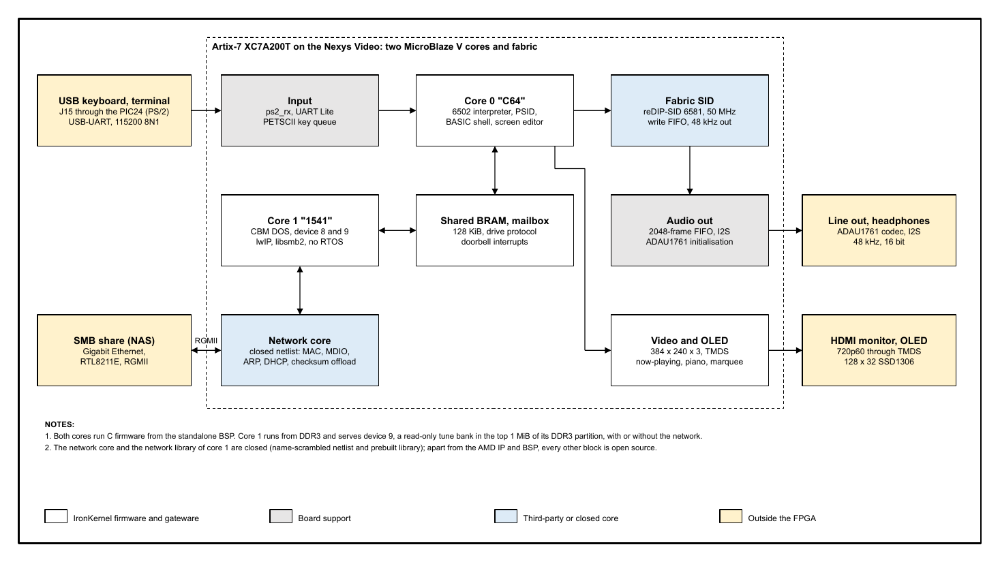

# IronKernel 64

A SID music machine with a C64-style shell, on a Digilent Nexys Video (AMD Artix-7 XC7A200T). Two MicroBlaze V cores run C firmware: core 0 ("C64") runs the screen editor, a 6502 interpreter and a PSID player; core 1 ("1541") emulates a disk drive that serves tunes from a network share (device 8) or from a built-in bank (device 9). The SID chip is the open-source reDIP-SID core in the FPGA. Video is 720p60 over HDMI, sound leaves through the board's ADAU1761 codec, and a 128 x 32 OLED shows the now-playing text.

Revision 11-10-2026. Documents: [specification](Documentation/ironkernel64_spec.pdf), [product brief](Documentation/ironkernel64_product_brief.pdf), [third-party notices](docs/THIRD_PARTY_NOTICES.md).



## What it does

- Type `LOAD"$",9`, `LIST`, `LOAD"CANON*",9`, `RUN` on a USB keyboard (J15) or on a UART terminal (115200 8N1). Everything printed on the screen is mirrored to the UART.
- The SID is gateware: core 0 runs the tune's 6502 code and queues every SID register write with its clock cycle; the fabric replays them into reDIP-SID (one 6581) at 985,248 Hz and sends 48 kHz audio to the codec.
- PSID v1 to v4, vertical-blank and CIA-timer play speed, PAL and NTSC. RSID, MUS data and play address 0 are rejected.
- The now-playing screen shows name, author, released, song n/m, time, three voice bars and two piano keyboards.
- Device 9 holds the public tune bank (9 arrangements of public-domain pieces) and works without a network. Device 8 reads an SMB share through lwIP and libsmb2 on core 1.
- Boots stand-alone from the board's QSPI flash: one image holds the bitstream, core 0's firmware, a core 1 bootloader, core 1's firmware and the tune bank. Set jumper JP4 to "SPI Flash".

## Quick start with the release image

1. Download `ik64_qspi.mcs` (and its SHA-256) from the GitHub release.
2. Write it to the Nexys Video's configuration flash: Vivado Hardware Manager, "Add Configuration Memory Device" `s25fl256sxxxxxx0-spi-x1_x2_x4`, program with erase and verify on; or, with this repository, `scripts/program_qspi.ps1 -Program ik64_qspi.mcs`.
3. Set JP4 to "SPI Flash" and press PROG (or power-cycle). `READY.` appears on HDMI and on the UART (115200 8N1) within a few seconds.
4. `LOAD"$",9`, `LIST`, `LOAD"CANON*",9`, `RUN`.

The release image has no network share configured: device 9 works out of the box; for device 8, build core 1 with your own `fw_1541/netshare_config.h` and make your own image (below). `c64_qspi.bit` in the release loads the same design over JTAG (core 1 then loads its image from the flash).

## Build and run

Needs Vivado and Vitis 2026.1, Python 3, and for the host tests MSYS2 UCRT64 GCC.

```
python -I tools/setup_third_party.py            # install third-party trees at their fixed commits
powershell -File scripts/ik64_vivado.ps1 ...     # bitstream: fpga/build_bitstream.tcl (WNS/WHS/CDC gates)
powershell -File fw_c64/build.ps1                # core 0 firmware (256 KiB LMB)
powershell -File fw_1541/build.ps1               # core 1 firmware (needs fw_1541/netshare_config.h)
python -I tools/mkpublicbank.py                  # build the public tune bank
powershell -File scripts/make_qspi.ps1           # single flash image: build/qspi/ik64_qspi.mcs
powershell -File scripts/program_qspi.ps1 -Program build/qspi/ik64_qspi.mcs   # write the flash, then -Reboot
powershell -File scripts/program.ps1             # development: program over JTAG ...
powershell -File scripts/jtag_load.ps1 -Core 1 -Bank build/bank/public.bin   # ... and load core 1
```

Copy `fw_1541/netshare_config.example.h` to `netshare_config.h` and fill in the share (the file is gitignored; credentials never go in the repository). Tests: `scripts/ik64_regression.ps1` (RTL), `python -I tools/public_bank_test.py`, and the `tools/*_host_test.c` programs. The network core is a closed netlist (`fpga/netlist/ik64_net_core.dcp`), so the whole bitstream builds from this tree without any network source.

## Commands

| Command | Effect |
|---|---|
| `LOAD"NAME",8` / `,9` | load from the share (8) or the built-in bank (9); wildcards `*` and `?`; the default device is 8 |
| `LOAD"$",8` / `,9` | load the directory as a program; `LIST` prints it; cursor up, edit the line into a `LOAD` and press RETURN |
| `RUN` | play the loaded SID |
| `NEW` | clear the loaded file |
| `@`, `@$`, `@$PATTERN` | DOS wedge: status line, directory without loading (uses the device of the last `LOAD`) |

Keys on the now-playing screen: **X** (or RUN/STOP, or Esc on the UART) breaks to `READY.`; **+** and **-** step songs; **1** to **9** pick a song. Ctrl-B on the UART switches to the engineering command line and back. Over the UART alone, send ESC, then `LOAD"NAME*",8` and `RUN` to switch tunes.

## Credits (short form)

Every item with its commit, licence and file locations is in chapter 14 of the specification; the licence texts are in [docs/THIRD_PARTY_NOTICES.md](docs/THIRD_PARTY_NOTICES.md). `python -I tools/check_credits.py` fails when something in the repository or the image is not credited.

| Item | Source | Licence | Used for |
|---|---|---|---|
| reDIP-SID | Dag Lem, github.com/daglem/reDIP-SID, commit 56608673 | CERN-OHL-S-2.0 | SID sound in fabric (`third_party/redip-sid/`, deviations in `fpga/DEVIATIONS.md`) |
| reSID | Dag Lem, github.com/libsidplayfp/resid, commit f8727828 | GPL-2.0-or-later | waveform and filter tables (`fw_c64/src/sid_tables.c`) |
| libsmb2 | Ronnie Sahlberg, github.com/sahlberg/libsmb2, commit a52c1571 | LGPL-2.1-or-later | SMB client of device 8 |
| lwIP 2.2.0 | lwip.nongnu.org, from the Vitis install | BSD-3-Clause | TCP/IP on core 1 |
| Open ROMs | MEGA65, github.com/MEGA65/open-roms, commit ad178dbe | LGPL-3.0-or-later (font), X11 (pngprepare.c) | 8x8 character set (`fw_c64/src/font_openroms.c`) |
| Dormann 6502 tests | Klaus Dormann, github.com/Klaus2m5/6502_65C02_functional_tests, commit 7954e2db | GPL-3.0 | `CPU TEST` |
| AMD IP, BSP, tools | AMD, Vivado and Vitis 2026.1 | AMD licence | MicroBlaze V, DDR3, AXI blocks, BSP |
| IronKernel network core and library | IronKernel (owner) | closed, exception below | Ethernet MAC, protocols, core 1 network drivers |
| RTLNet | IronKernel (owner) | owner's own code | block design and script patterns (`fpga/bd/c64_bd.tcl`, `scripts/`) |
| Digilent board files, master XDC, manual | Digilent | MIT (files); manual is reference | pins, DDR3 settings, board facts |
| C64_MiSTer, FPGA64 | MiSTer-devel, Peter Wendrich | to verify | reference only, no file used |
| Colodore palette | Philip "Pepto" Timmermann | no licence stated | palette values (`fw_c64/src/video.c`) |
| VIC-II article | Christian Bauer | no licence stated | reference only |
| siddump | Lasse Oorni (Cadaver) and others | BSD-style, to verify | reference only |
| sidplayfp | libsidplayfp team | GPL-2.0 | listening reference |
| SD2IEC | sd2iec.de | to verify | command conventions, reference only |
| HVSC, STIL, PSID format | HVSC team, hvsc.c64.org | collection terms | test tunes (not redistributed), format reference |
| SSD1306, RTL8211E, ADAU1761 data sheets | Solomon Systech, Realtek, Analog Devices | data sheets | reference only |
| MenuBuilder CLI | generated for the owner, Steve Spano | LGPL-2.1-or-later | engineering command line (`fw_c64/cli/`) |
| Tools | Active-HDL, Verilator, MSYS2 GCC, Python, Node.js, pptxgenjs, LibreOffice, poppler, Chrome | own licences | build, simulation, drawings, PDFs |

Public tune bank (arrangement "IronKernel 2026, GPL-3.0-or-later"; compositions public domain): Canon in D (Pachelbel), Fur Elise (Beethoven), Greensleeves (traditional), Two-Part Invention 13 (Bach; notes from the Mutopia Project edition typeset by Allen Garvin after the Bach-Gesellschaft, Public Domain), Jingle Bells (Pierpont), Minuet in G (Petzold), Hall of the Mountain King (Grieg), Ode to Joy (Beethoven), Toccata in D minor (Bach). HVSC tunes used for testing live on the owner's network share only and are not redistributed.

## Licences

- Firmware, tools and scripts: GPL-3.0-or-later (`LICENSE`).
- FPGA gateware (`fpga/`): GPL-3.0-or-later OR CERN-OHL-S-2.0. The bitstream contains reDIP-SID, so the bitstream as a whole is distributed under CERN-OHL-S-2.0.
- Third-party items keep their own licences (table above, notices file).
- Closed parts: the network core netlist (`fpga/netlist/ik64_net_core.dcp`) and the library (`fw_1541/lib/libik64_netcore.a`) have no sources. Exception (owner decision 11-10-2026): the copyright holders permit combining the GPL parts with these closed parts and conveying the combination, provided the closed parts are distributed unmodified and used only through the documented interfaces (`fpga/netlist/ik64_net_core.md`, `fw_1541/lib/ik64_netcore.h`).
- Never committed: HVSC tunes, C64 ROM images, `netshare_config.h`.

## Trademark

Commodore 64 is a trademark of its owner. IronKernel 64 is an unaffiliated hobby project and contains no Commodore ROMs.
