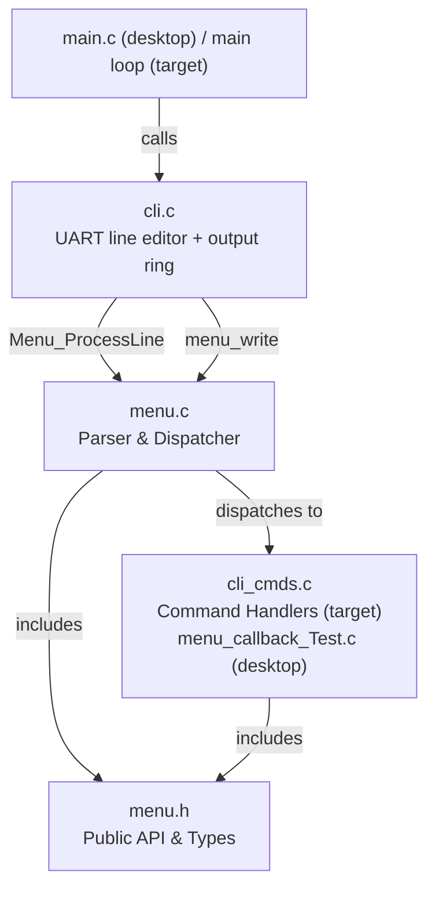
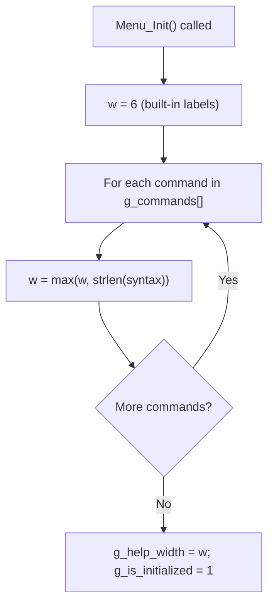
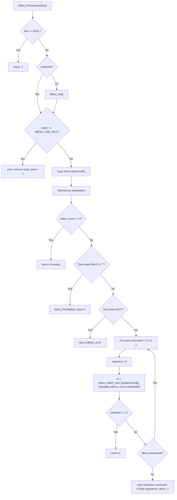
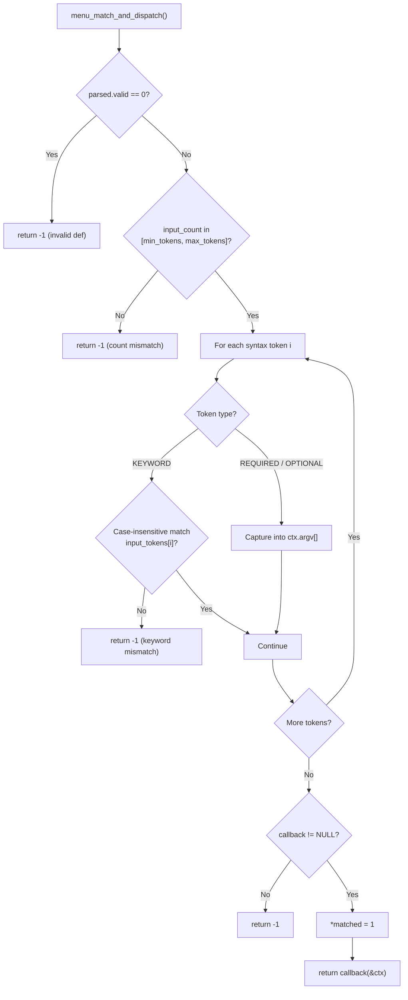
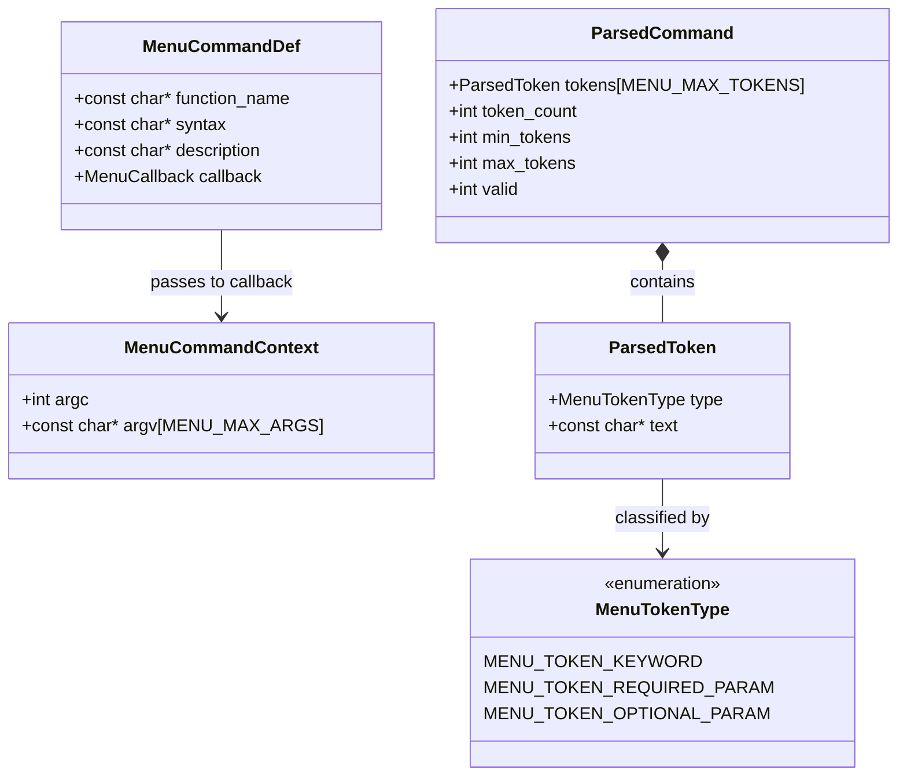

<!--
Copyright (C) 2026 — Generated by MenuBuilder AI, inspired by Steve Spano

This file is free software; you can redistribute it and/or
modify it under the terms of the GNU Lesser General Public
License as published by the Free Software Foundation; either
version 2.1 of the License, or (at your option) any later version.

This file is distributed in the hope that it will be useful,
but WITHOUT ANY WARRANTY; without even the implied warranty of
MERCHANTABILITY or FITNESS FOR A PARTICULAR PURPOSE.  See the GNU
Lesser General Public License for more details.

You should have received a copy of the GNU Lesser General Public
License along with this library; if not, write to the Free Software
Foundation, Inc., 51 Franklin Street, Fifth Floor, Boston, MA  02110-1301
USA

SPDX-License-Identifier: LGPL-2.1-or-later
-->

# IronKernel 64 core 0 CLI -- Menu Documentation

Revision: 11-10-2026 (Initial generation: 12 commands (VERSION, DDR INFO, SID STATUS, AUDIO STATUS, CODEC READ/WRITE, DRIVE STATUS/CMD, VIDEO STATUS/PALETTE, KEYBOARD STATS)) -- generated 2026-11-10 from `fw_c64/cli/cli_commands.txt` by `tools/gen_cli_menu.py`.

## 1. Overview

The CLI is the engineering console of core 0. Ctrl-B on the UART (115200 8N1) toggles it; the C64 screen keeps running. It has 11 commands plus the built-ins `HELP`, `?` and `EXIT`. Commands are case-insensitive, `[ARG]` is required, `{ARG}` optional, numbers are decimal or `0x` hex. `menu.c` is portable ISO C11 with constant tables and no heap; the platform supplies `menu_write()`.

## 2. Architecture Overview



## 3. Initialization Flow

The per-command metadata is generated as constant tables, so `Menu_Init()` only computes the help column.



## 4. Command Processing & Dispatch Flow



## 5. Token Matching Detail



## 6. Data Structures



## 7. Command Reference

| # | Function | Command Syntax | Required | Optional | Min | Max | Description |
|---|----------|----------------|----------|----------|-----|-----|-------------|
| 1 | cli_version | `VERSION` | — | — | 1 | 1 | Show build ID, dirty flag and the clock lock and link status bits |
| 2 | cli_ddr_info | `DDR INFO` | — | — | 2 | 2 | Show DDR3 calibration time, probed size, free bytes and pattern test result |
| 3 | cli_sid_status | `SID STATUS` | — | — | 2 | 2 | Show the current tune, song, elapsed time, voice levels and player counters |
| 4 | cli_audio_status | `AUDIO STATUS` | — | — | 2 | 2 | Show audio FIFO level, threshold, underrun count and status flags |
| 5 | cli_codec_read | `CODEC READ [REG]` | REG | — | 3 | 3 | Read one ADAU1761 register over I2C (REG 0x4000 to 0x40FA) |
| 6 | cli_codec_write | `CODEC WRITE [REG] [VALUE]` | REG, VALUE | — | 4 | 4 | Write one ADAU1761 register over I2C (idle) |
| 7 | cli_drive_status | `DRIVE STATUS` | — | — | 2 | 2 | Ping devices 8 and 9 and show the DOS status line (idle) |
| 8 | cli_drive_cmd | `DRIVE CMD [TEXT]` | TEXT | — | 3 | 3 | Send one DOS command word on channel 15 such as I or UI and show the status (idle) |
| 9 | cli_video_status | `VIDEO STATUS` | — | — | 2 | 2 | Show frame counter, vsync count, front page and flip state |
| 10 | cli_video_palette | `VIDEO PALETTE [INDEX] [RGB]` | INDEX, RGB | — | 4 | 4 | Set one palette entry (INDEX 0 to 15) to 0xRRGGBB |
| 11 | cli_keyboard_stats | `KEYBOARD STATS` | — | — | 2 | 2 | Show dropped keys and bytes and the UART and PS2 error counts |

Built-ins: `HELP` and `?` (same output), `EXIT` (returns `MENU_EXIT`; the firmware leaves CLI mode).

## 8. Build Instructions

Desktop harness (`fw_c64/cli/desktop/`):

```
build.bat          REM Windows: compile and link
build.bat demo     REM build + demo mode
make               # Linux/macOS: compile and link
make demo          # build + demo mode
```

Firmware: `powershell -NoProfile -ExecutionPolicy Bypass -File fw_c64/build.ps1` compiles `menu.c`, `cli.c` and
`cli_cmds.c` with the rest of core 0. Regenerate with `python -I tools/gen_cli_menu.py`; verify with `--check`.
